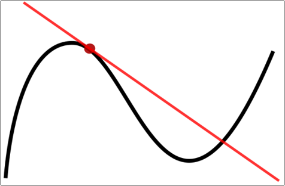
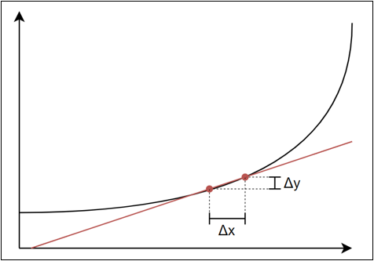

# 第 1 章 高等数学
## 1.1 导数
### 1.1.1 导数的概念
- **导数**（derivative）是微积分中的一个概念。函数在某一点的导数是指这个函数在这一点附近的变化率（即函数在这一点的切线斜率）。导数的本质是通过极限的概念对函数进行局部的线性逼近。
 

- 当函数$f$的自变量在一点$x_0$上产生一个增量$h$时，函数输出值的增量$\Delta y$与自变量增量$\Delta x$的比值在$\Delta x$趋于$0$时的极限如果存在，即为$f$在$x_0$处的导数，记作$f'(x_0)$、$\frac{df}{dx}(x_0)$或$\left.\frac{df}{dx}\right|_{x=x_0}$。
$$
f'(x_0)=\lim_{\Delta x \to 0}\frac{f(x_0+\Delta x)-f(x_0)}{\Delta x}
$$

例如在运动学中，物体的位移对于时间的导数就是物体的瞬时速度：$v = \frac{dx}{dt}$。
### 1.1.2 基本函数的导数

| 说明 | 公式 | 例子 |
| ---- | ---- | ---- |
| 常数的导数 | $(C)' = 0$ | $(3)' = 0$ |
| 幂函数的导数 | $(x^\alpha)' = \alpha x^{\alpha-1}$ | $(x^3)' = 3x^2$ |
| 指数函数的导数 | $(a^x)' = a^x \ln a$ | $(3^x)' = 3^x \ln3$ |
| | $(e^x)' = e^x$ | $-$ |
| 对数函数的导数 | $(\log_a x)' = \frac{1}{x\ln a}$ | $(\log_3 x)' = \frac{1}{x\ln3}$ |
| | $(\ln x)' = \frac{1}{x}$ | $-$ |
| 三角函数的导数 | $(\sin x)' = \cos x$ | $-$ |
| | $(\cos x)' = -\sin x$ | $-$ |
| | $(\tan x)' = \sec^2 x = \frac{1}{\cos^2 x}$ | $-$ |
| | $(\cot x)' = -\csc^2 x = \frac{-1}{\sin^2 x}$ | $-$ |

### 1.1.3 导数的求导法则

| 说明      | 公式                                                  |
| ------- | --------------------------------------------------- |
| 两函数之和求导 | $(f+g)' = f' + g'$                                  |
| 两函数之积求导 | $(fg)' = f'g + fg'$                                 |
| 两函数之商求导 | $\left(\frac{f}{g}\right)' = \frac{f'g - fg'}{g^2}$ |
| 复合函数的导数 | 若$f(x) = h[g(x)]$，则$f'(x) = h'[g(x)] \cdot g'(x)$   |
