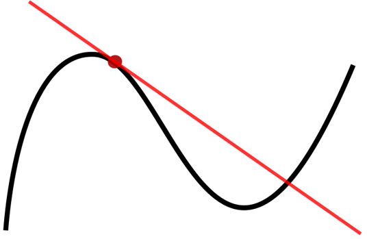
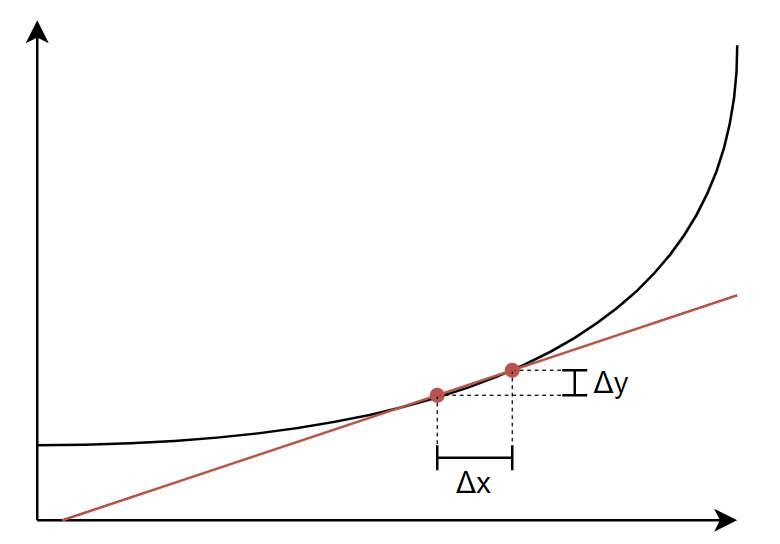
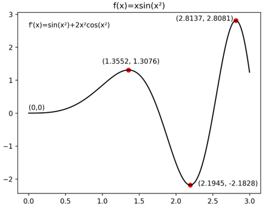
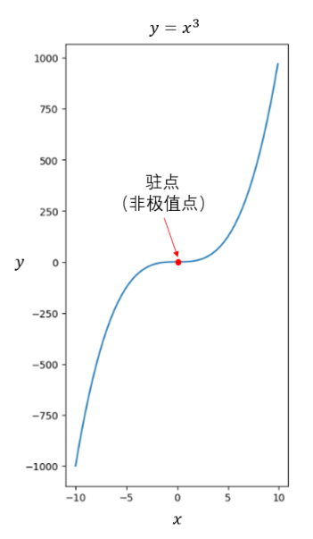
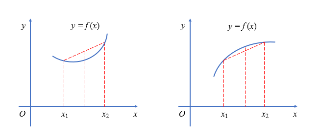
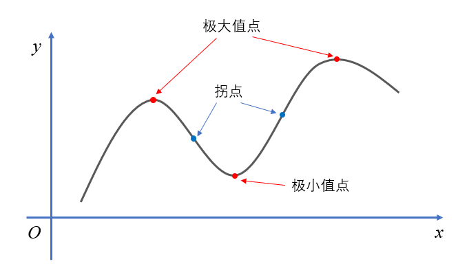
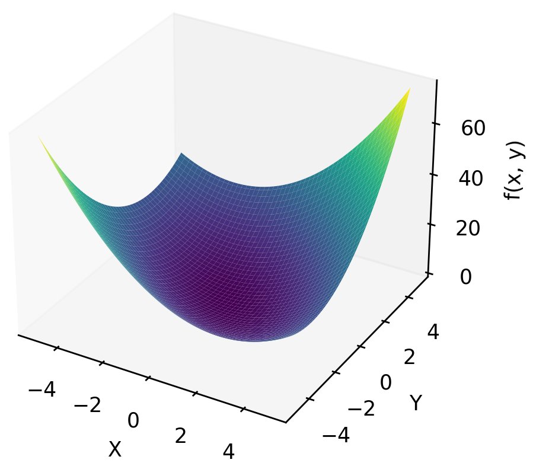
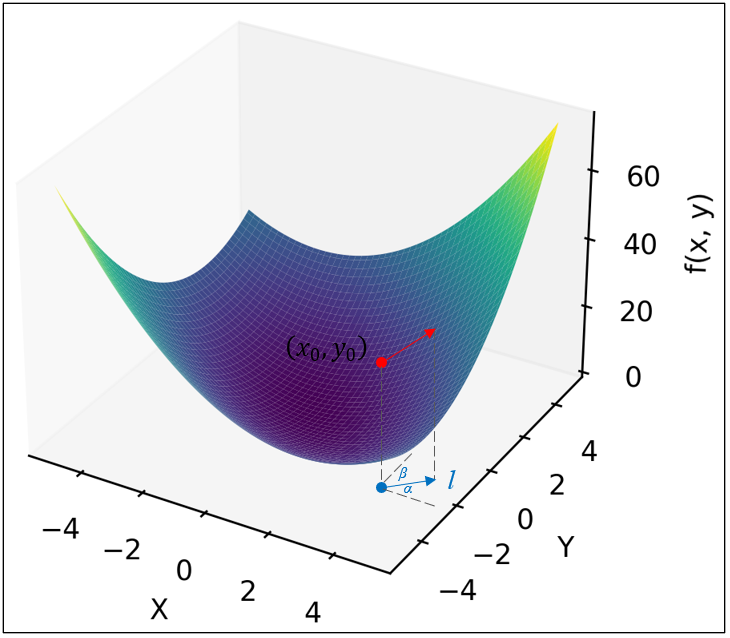
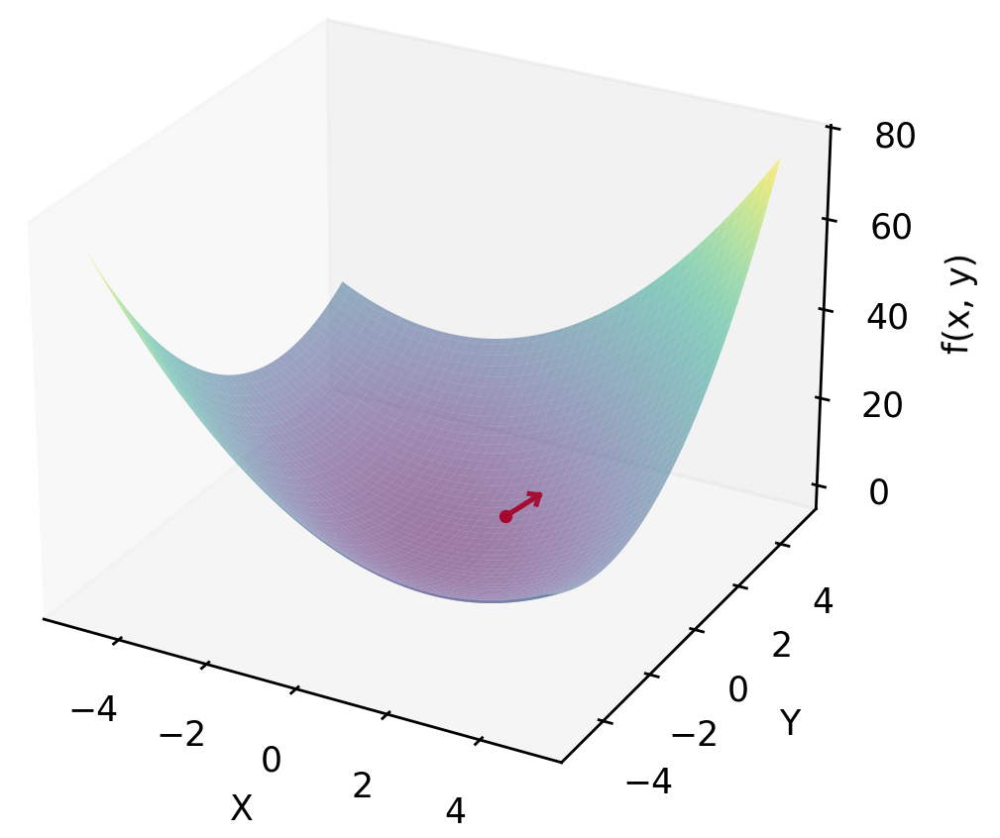
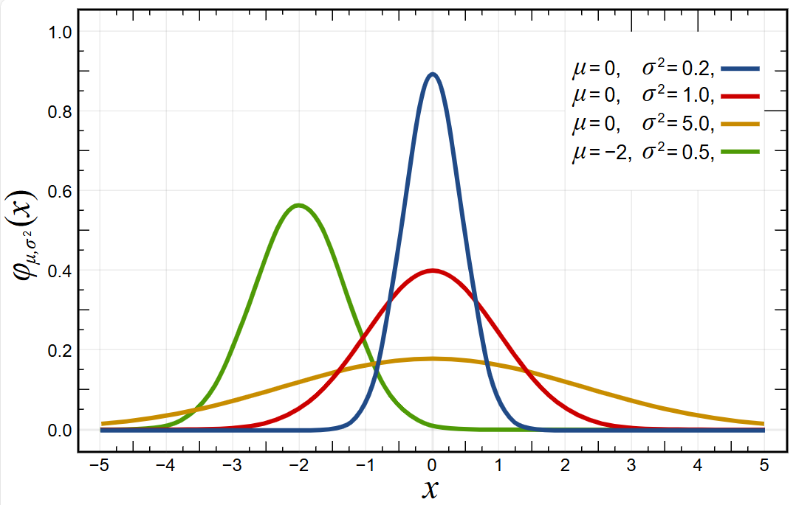

尚硅谷大模型技术之数学基础

（作者：尚硅谷研究院）

版本：V1.2.1

1.  高等数学

    1.  导数

        1.  导数的概念

**导数**（derivative）是微积分中的一个概念。函数在某一点的导数是指这个函数在这一点附近的变化率（即函数在这一点的切线斜率）。导数的本质是通过极限的概念对函数进行局部的线性逼近。

当函数$f$的自变量在一点$x_{0}$上产生一个增量$h$时，函数输出值的增量$\mathrm{\Delta}y$与自变量增量$\mathrm{\Delta}x$的比值在$\mathrm{\Delta}x$趋于0时的极限如果存在，即为$f$在$x_{0}$处的导数，记作$f'(x_{0})$、$\frac{df}{dx}(x_{0})$或${\frac{df}{dx}|}_{x = x_{0}}$。

$$
f'\left( x_{0} \right) = \lim_{\mathrm{\Delta}x \rightarrow 0}\frac{f\left( x_{0} + \mathrm{\Delta}x \right) - f(x_{0})}{\mathrm{\Delta}x}
$$

例如在运动学中，物体的位移对于时间的导数就是物体的瞬时速度：$v = \frac{dx}{dt}$。

2.  基本函数的导数

| **说明** | **公式** | **例子** |
|:--:|:--:|:--:|
| **常数的导数** | $(C)' = 0$ | $(3)' = 0$ |
| **幂函数的导数** | $\left( x^{\alpha} \right)' = \alpha x^{\alpha - 1}$ | $\left( x^{3} \right)' = 3x^{2}$ |
| **指数函数的导数** | $\left( a^{x} \right)' = a^{x}\ln a$ | $\left( 3^{x} \right)' = 3^{x}\ln 3$ |
|  | $\left( e^{x} \right)' = e^{x}$ | — |
| **对数函数的导数** | $\left( \log_{a}x \right)' = \frac{1}{x\ln a}$ | $\left( \log_{3}x \right)' = \frac{1}{x\ln 3}$ |
|  | $\left( \ln x \right)' = \frac{1}{x}$ | — |
| **三角函数的导数** | $\left( \sin x \right)' = \cos x$ | — |
|  | $\left( \cos x \right)' = {- sin}x$ | — |
|  | $\left( \tan x \right)' = \sec^{2}x = \frac{1}{\cos^{2}x}$ | — |
|  | $\left( \cot x \right)' = {- csc}^{2}x = \frac{- 1}{\sin^{2}x}$ | — |

3.  导数的求导法则

| **说明** | **公式** |
|:--:|:--:|
| **两函数之和求导** | $(f + g)' = f' + g'$ |
| **两函数之积求导** | $(fg)' = f'g + fg'$ |
| **两函数之商求导** | $\left( \frac{f}{g} \right)' = \frac{f'g - fg'}{g^{2}}$ |
| **复合函数的导数** | $若f(x) = h\left\lbrack g(x) \right\rbrack,则f'(x) = h'\left\lbrack g(x) \right\rbrack \bullet g'(x)$ |

例如：求函数$f(x) = x^{4} + \sin\left( x^{2} \right) - \ln(x)e^{x} + 7$在$x = 3$处的导数。

$$
{f'(x) = 4x^{4 - 1} + \cos\left( x^{2} \right) \bullet 2x - \left( \frac{e^{x}}{x} + \ln(x)e^{x} \right) + 0
}{= 4x^{3} + 2xcos\left( x^{2} \right) - \frac{e^{x}}{x} - \ln(x)e^{x}
}{f'(3) = 108 + 6\cos(9) - \frac{e^{3}}{3} - \ln(3)e^{3}}
$$

4.  利用导数求极值

导数等于零的点称为函数的**驻点**（或极值可疑点），在这类点上函数可能会取得**极大值**或**极小值**。进一步判断则需要知道导数在附近的符号。

例如，$f(x) = x^{3}$ 在 $x = 0$ 处导数为0，但并不会取得极大值或者极小值。

 

5.  二阶导数

    1.  二阶导数的概念

在微积分中，函数的二阶导数是函数导数的导数。粗略来说，某个量的二阶导数描述该量变化率变化的快慢。例如物体位置对时间的二阶导数是物体的瞬时加速度，即该物体速度随时间的变化率：$a = \frac{dv}{dt} = \frac{d^{2}x}{dt^{2}}$。

函数$f$的二阶导数通常记作$f''$、$\frac{d^{2}y}{dx^{2}}$或$\frac{d}{dx}\left( \frac{dy}{dx} \right)$。

2.  二阶导数与函数凹凸的关系

函数的二阶导数描述了函数图像的凹凸方向和程度。若二阶导数在某区间恒为正，则函数在该区间向上弯（也称**下凸函数**）。反之，若二阶导数在某区间恒为负，则函数在该区间向下弯（也称**上凸函数**）。

若函数的二阶导数在某点左右异号，则图像由向上弯转为向下弯，或反之。这种点称之为**拐点**。若二阶导数连续，则在该点处二阶导数为0。但反之二阶导数为0的点不一定是拐点。如$f(x) = x^{4}$，在$x = 0$处有$f''(0) = 0$，但$f(x)$在实数系上无拐点。

二阶导数与凹凸性的关系有助于判断函数的驻点是否为极大值点或极小值点：

- 若$f'(x) = 0$，$f^{''}(x) < 0$，则$f$在$x$取得极大值。

- 若$f'(x) = 0$，$f^{''}(x) > 0$，则$f$在$x$取得极小值。

- 若$f'(x) = 0$，$f^{''}(x) = 0$，则该点可能是拐点，也可能是极大值点或极小值点。

  1.  偏导与梯度

      1.  偏导数

如果函数$f$的自变量并非单个元素，而是多个元素，例如：

$$
f(x,y) = x^{2} + xy + y^{2}
$$

可将其中一个元素$x$看作常数，此时$f$可看作关于另一元素$y$的函数。

$$
f_{x}(y) = x^{2} + xy + y^{2}
$$

在$x = a$固定的情况下，可计算$f_{x}$关于$y$的导数：

$$
f_{x = a}'(y) = a + 2y
$$

这种导数称为**偏导数**，一般记作：

$$
\frac{\partial f}{\partial y}(x,y) = x + 2y
$$

更一般地来说，一个多元函数$f\left( x_{1},x_{2},\ldots,x_{n} \right)$在点$\left( a_{1},a_{2},\ldots,a_{n} \right)$处对$x_{i}$的偏导数定义为：

$$
\frac{\partial f}{\partial x_{i}}\left( a_{1},a_{2},\ldots,a_{n} \right) = \lim_{\mathrm{\Delta}x_{i} \rightarrow 0}\frac{f\left( a_{1},\ldots a_{i} + \mathrm{\Delta}x_{i},\ldots,a_{n} \right) - f(a_{1},\ldots a_{i},\ldots,a_{n})}{\mathrm{\Delta}x_{i}}
$$

2.  方向导数

偏导数可以看作是多元函数$\ f$沿某个自变量轴方向的变化率。

如果我们任意选取一个方向*l*，那么在某个点$\left( x_{0},y_{0} \right)$处，二元函数$f(x,y)$沿着这个方向的变化率可以用极限定义为：

$$
\frac{\partial f}{\partial l}\left( x_{0},y_{0} \right) = \lim_{\mathrm{\Delta}l \rightarrow 0}\frac{f\left( x_{0} + \mathrm{\Delta}x,\ y_{0} + \mathrm{\Delta}y \right) - f(x_{0},\ y_{0})}{\mathrm{\Delta}l}
$$

这里，$\mathrm{\Delta}l$ 就是沿方向*l*的微小改变量，$\mathrm{\Delta}x$ 和 $\mathrm{\Delta}y$ 与 $\mathrm{\Delta}l$ 的关系为：

$\mathrm{\Delta}x = \ \mathrm{\Delta}l \cdot \ cos\alpha$，$\mathrm{\Delta}y = \ \mathrm{\Delta}l \cdot \ cos\beta$

根据全微分公式，上式可以表示为：

$$
\frac{\partial f}{\partial l}\left( x_{0},y_{0} \right) = f_{x}\left( x_{0},y_{0} \right)\cos\alpha + f_{y}\left( x_{0},y_{0} \right)\cos\beta
$$

其中$f_{x}\left( x_{0},y_{0} \right)、f_{y}\left( x_{0},y_{0} \right)$ 表示点$\left( x_{0},y_{0} \right)$处*f*对*x*、*y*的偏导数；$\cos\alpha 、\cos\beta$是方向*l*的方向余弦，即*l*方向的单位方向向量可以表示为$l_{0} = (\cos\alpha,\ \ \cos\beta)$。

这个“沿某个方向的变化率”，就被称为$f(x,y)$沿方向*l*的**方向导数**。

3.  梯度

多元函数$f\left( x_{1},\ldots,x_{n} \right)$关于每个变量$x_{i}$都有偏导数$\frac{\partial f}{\partial x_{i}}$，在点$a = \left( a_{1},a_{2},\ldots,a_{n} \right)$ 处，这些偏导数定义出一个向量：

$$
\nabla f(a) = \left\lbrack \frac{\partial f}{\partial x_{1}}(a),\frac{\partial f}{\partial x_{2}}(a),\ldots,\frac{\partial f}{\partial x_{n}}(a) \right\rbrack
$$

这个向量称为$f$在点$a$的**梯度**，记作 $\nabla f(a)$ 或者$\ \mathbf{grad}\ f(a)$。

例如：$f(x,y) = x^{2} + xy + y^{2}$在$(1,1)$处的梯度为$\lbrack 3,3\rbrack$。

梯度向量表示的方向，就是函数在这一点处，方向导数取最大值的方向。换句话说，梯度的方向，就是函数值变化最快的方向。

2.  线性代数

    1.  标量与向量

        1.  标量与向量的概念

            1.  标量（scalar）

标量是一个单独的数，只有大小。

2.  向量（vector）

向量由标量组成，有大小有方向。

行向量：$\begin{pmatrix} 2 & 5 & 8 \end{pmatrix}$

列向量：$\begin{pmatrix} 2 \\ 5 \\ 8 \end{pmatrix}$

2.  向量运算

    1.  向量转置：列向量转置结果为行向量

$$
{\mathbf{x} = \begin{pmatrix}
2 \\
5 \\
8
\end{pmatrix}
}{\mathbf{x}^{\mathbf{T}}\mathbf{=}\begin{pmatrix}
2 & 5 & 8
\end{pmatrix}}
$$

2.  向量相加：对应元素相加

$$
\begin{pmatrix}
2 \\
5 \\
8
\end{pmatrix} + \begin{pmatrix}
1 \\
3 \\
7
\end{pmatrix} = \begin{pmatrix}
3 \\
8 \\
15
\end{pmatrix}
$$

3.  向量与标量相乘：标量与向量每个元素相乘

$$
3 \times \begin{pmatrix}
2 \\
5 \\
8
\end{pmatrix} = \begin{pmatrix}
6 \\
15 \\
24
\end{pmatrix}\ 
$$

4.  向量内积：又称向量点乘，两向量对应元素乘积之和，结果为标量

$$
\left\langle \mathbf{x},\mathbf{y} \right\rangle = \left\langle \begin{pmatrix}
2 \\
5 \\
8
\end{pmatrix},\begin{pmatrix}
1 \\
3 \\
7
\end{pmatrix} \right\rangle = 2 + 15 + 56 = 73
$$

两向量之间夹角表示为

$$
\cos\theta = \frac{\left\langle \mathbf{x},\mathbf{y} \right\rangle}{\sqrt{\left\langle \mathbf{x},\mathbf{x} \right\rangle}\sqrt{\left\langle \mathbf{y},\mathbf{y} \right\rangle}}
$$

3.  向量范数

范数（norm）是具有“长度”概念的函数。

1.  L₀范数（也称0范数）

$$
\left\| \mathbf{x} \right\|_{0} = 非零元素的个数
$$

例如：

$$
\mathbf{x} = \begin{pmatrix}
0 \\
2 \\
 - 1
\end{pmatrix},\left\| \mathbf{x} \right\|_{0} = 2
$$

2.  L₁范数（也称和范数或1范数）

$$
\left\| \mathbf{x} \right\|_{1} = \sum_{i = 1}^{m}\left| x_{i} \right| = \left| x_{1} \right| + \ldots + \left| x_{m} \right|
$$

例如：

$$
\mathbf{x} = \begin{pmatrix}
0 \\
2 \\
 - 1
\end{pmatrix},\ \left\| \mathbf{x} \right\|_{1} = 0 + 2 + 1 = 3
$$

3.  L₂范数（也称欧几里得范数或2范数）

$$
\left\| \mathbf{x} \right\|_{2} = \left( \sum_{i = 1}^{m}\left| x_{i} \right|^{2} \right)^{\frac{1}{2}} = \sqrt{\left( \left| x_{1} \right|^{2} + \ldots + \left| x_{m} \right|^{2} \right)}
$$

例如：

$$
\mathbf{x} = \begin{pmatrix}
0 \\
2 \\
 - 1
\end{pmatrix},\ \left\| \mathbf{x} \right\|_{2} = \sqrt{0 + 4 + 1} = \sqrt{5}
$$

4.  L_(p)范数

$$
\left\| \mathbf{x} \right\|_{p} = \left( \sum_{i = 1}^{m}\left| x_{i} \right|^{p} \right)^{\frac{1}{p}} = \left( \left| x_{1} \right|^{p} + \ldots + \left| x_{m} \right|^{p} \right)^{\frac{1}{p}}
$$

在numpy中，可以利用linalg.norm 函数方便地计算向量的范数。

2.  矩阵与张量

    1.  矩阵的概念

一个$m \times n$的矩阵（matrix）是一个有m行n列元素的矩形阵列。用$R^{m \times n}$表示所有$m \times n$实数矩阵的向量空间。

$$
\begin{bmatrix}
1 & 2 \\
3 & 5 \\
4 & 8
\end{bmatrix} \in R^{3 \times 2}
$$

1.  方阵：行数等于列数的矩阵

$$
\begin{bmatrix}
1 & 2 \\
3 & 4
\end{bmatrix} \in R^{2 \times 2}
$$

2.  对角矩阵：主对角线以外元素全为0的方阵

$$
\begin{bmatrix}
1 & 0 & 0 \\
0 & 5 & 0 \\
0 & 0 & 9
\end{bmatrix}
$$

3.  单位矩阵：主对角线元素全为1的对角矩阵

$$
\mathbf{I}_{3 \times 3} = \begin{bmatrix}
1 & 0 & 0 \\
0 & 1 & 0 \\
0 & 0 & 1
\end{bmatrix}
$$

2.  矩阵乘法

    1.  矩阵乘法运算

两个矩阵的乘法仅当矩阵$\mathbf{A}$的列数和矩阵$\mathbf{B}$的行数相等时才能定义。如$\mathbf{A} \in R^{m \times n}$，$\mathbf{B} \in R^{n \times p}$，它们的乘积$\mathbf{AB} \in R^{m \times p}$

$$
\left\lbrack \mathbf{A}\mathbf{B} \right\rbrack_{ij}\mathbf{=}a_{i1}b_{1j}\mathbf{+}a_{i2}b_{2j}\mathbf{+ \ldots +}a_{in}b_{nj}\mathbf{=}\sum_{r = 1}^{n}{a_{ik}b_{kj}}
$$

例如：

$$
\begin{bmatrix}
1 & 0 & 2 \\
 - 1 & 3 & 1
\end{bmatrix} \times \begin{bmatrix}
3 & 1 \\
2 & 1 \\
1 & 0
\end{bmatrix} = \begin{bmatrix}
1 \times 3 + 0 \times 2 + 2 \times 1 & 1 \times 1 + 0 \times 1 + 2 \times 0 \\
( - 1) \times 3 + 3 \times 2 + 1 \times 1 & ( - 1) \times 1 + 3 \times 1 + 1 \times 0
\end{bmatrix} = \begin{bmatrix}
5 & 1 \\
4 & 2
\end{bmatrix}
$$

特别地，矩阵与单位矩阵相乘等于矩阵本身：

$\mathbf{AI} = \mathbf{A}\left( \mathbf{A \in}R^{m \times n},\mathbf{I \in}R^{n \times n} \right)$ 或 $\mathbf{IA} = \mathbf{A}\left( \mathbf{I \in}R^{n \times n}\mathbf{,A \in}R^{n \times m} \right)$

例如：

$$
\mathbf{AI} = \begin{bmatrix}
1 & 2 \\
3 & 5 \\
4 & 8
\end{bmatrix} \times \begin{bmatrix}
1 & 0 \\
0 & 1
\end{bmatrix} = \begin{bmatrix}
1 \times 1 + 2 \times 0 & 1 \times 0 + 2 \times 1 \\
3 \times 1 + 5 \times 0 & 3 \times 0 + 5 \times 1 \\
4 \times 1 + 8 \times 0 & 4 \times 0 + 8 \times 1
\end{bmatrix} = \begin{bmatrix}
1 & 2 \\
3 & 5 \\
4 & 8
\end{bmatrix} = \mathbf{A}
$$

2.  矩阵乘法的性质

    矩阵乘法满足结合律、左分配律和右分配律。不满足交换律即$\mathbf{AB \neq BA}$。

    结合律：若$\mathbf{A} \in R^{m \times n},\mathbf{B} \in R^{n \times p},\mathbf{C} \in R^{p \times q}$，则$\left( \mathbf{AB} \right)\mathbf{C} = \mathbf{A}\left( \mathbf{BC} \right)$

    左分配律：若$\mathbf{A} \in R^{m \times n},\mathbf{B} \in R^{m \times n},\mathbf{C} \in R^{n \times p}$，则$\left( \mathbf{A} + \mathbf{B} \right)\mathbf{C} = \mathbf{AC} + \mathbf{BC}$

    右分配律：若$\mathbf{A} \in R^{m \times n},\mathbf{B} \in R^{n \times p},\mathbf{C} \in R^{n \times p}$，则$\mathbf{A}\left( \mathbf{B} + \mathbf{C} \right) = \mathbf{AB} + \mathbf{AC}$

&nbsp;

3.  矩阵转置

    1.  矩阵转置运算

矩阵$\mathbf{A} \in R^{m \times n}$的转置是一个$n \times m$的矩阵，记为$\mathbf{A}^{T}$。其中的第$i$个行向量是原矩阵的第$i$个列向量；或者说，转置矩阵$\mathbf{A}^{T}$第$i$行第$j$列的元素是原矩阵$\mathbf{A}$第$j$行第$i$列的元素。

$$
{\left\lbrack \mathbf{A}^{T} \right\rbrack_{ij} = a_{ji}
}{\mathbf{A =}\begin{bmatrix}
1 & 2 \\
3 & 5 \\
4 & 8
\end{bmatrix} \in R^{3 \times 2}
}{\mathbf{A}^{T}\mathbf{=}\begin{bmatrix}
1 & 3 & 4 \\
2 & 5 & 8
\end{bmatrix} \in R^{2 \times 3}}
$$

2.  矩阵转置的性质

> 
> $$
> \left( \mathbf{A}^{T} \right)^{T}\mathbf{=}\mathbf{A}
> $$
>
> $$
> \left( \mathbf{A}\mathbf{+}\mathbf{B} \right)^{T}\mathbf{=}\mathbf{A}^{T}\mathbf{+}\mathbf{B}^{T}
> $$
>
> $$
> \left( \mathbf{kA} \right)^{T}\mathbf{=}\mathbf{kA}^{T}
> $$
>
> $$
> \left( \mathbf{AB} \right)^{T}\mathbf{=}\mathbf{B}^{T}\mathbf{A}^{T}
> $$

4.  矩阵的逆

对于方阵$\mathbf{A}$，如果存在另一个方阵$\mathbf{A}^{- 1}$，使得$\mathbf{A}\mathbf{A}^{- 1}\mathbf{= I}$成立，此时$\mathbf{A}^{- 1}\mathbf{A = I}$也同样成立。称$\mathbf{A}^{- 1}$为$\mathbf{A}$的逆矩阵。例如：

$$
\mathbf{A}\mathbf{A}^{- 1}\mathbf{=}\begin{bmatrix}
1 & 2 \\
3 & 5
\end{bmatrix} \times \begin{bmatrix}
 - 5 & 2 \\
3 & - 1
\end{bmatrix} = \begin{bmatrix}
1 \times ( - 5) + 2 \times 3 & 1 \times 2 + 2 \times ( - 1) \\
3 \times ( - 5) + 3 \times 5 & 3 \times 2 + 5 \times ( - 1)
\end{bmatrix} = \begin{bmatrix}
1 & 0 \\
0 & 1
\end{bmatrix}\mathbf{= I}
$$

5.  其他矩阵运算

    1.  矩阵的向量化

矩阵$\mathbf{A} \in R^{m \times n}$的向量化$vec\left( \mathbf{A} \right)$将矩阵$\mathbf{A}$的元素按列排列成一个$mn \times 1$的向量。

$$
vec\left( \mathbf{A} \right)\mathbf{=}\left\lbrack a_{11},\ldots a_{m1},\ldots a_{1n},\ldots a_{mn} \right\rbrack^{T}
$$

矩阵也可以转化为行向量$rvec\left( \mathbf{A} \right)$，称为矩阵的行向量化。

$$
rvec\left( \mathbf{A} \right)\mathbf{=}\left\lbrack a_{11},\ldots a_{1n},\ldots a_{m1},\ldots a_{mn} \right\rbrack
$$

例如：$\mathbf{A =}\begin{bmatrix} 1 & 2 \\ 3 & 4 \end{bmatrix},vec\left( \mathbf{A} \right)\mathbf{=}\begin{pmatrix} 1 \\ 3 \\ 2 \\ 4 \end{pmatrix}\mathbf{,\ }rvec\left( \mathbf{A} \right)\mathbf{=}\begin{pmatrix} 1 & 2 & 3 & 4 \end{pmatrix}$**。**

2.  矩阵的内积

矩阵$\mathbf{A} \in R^{m \times n}$和矩阵$\mathbf{B} \in R^{m \times n}$的内积记作$\left\langle \mathbf{A,B} \right\rangle$，它是两个矩阵对应元素乘积之和，是一个标量。

$$
\left\langle \mathbf{A,B} \right\rangle\mathbf{=}\left\langle vec\left( \mathbf{A} \right)\mathbf{,}vec\left( \mathbf{B} \right) \right\rangle\mathbf{=}\sum_{}^{}{a_{i,j}b_{i,j}}
$$

3.  矩阵的Hadamard积

矩阵$\mathbf{A} \in R^{m \times n}$和矩阵$\mathbf{B} \in R^{m \times n}$的Hadamard积记作$\mathbf{A\bigodot B}$，它是两个矩阵对应元素的乘积，是一个$m \times n$的矩阵。

$$
\left( \mathbf{A\bigodot B} \right)_{ij}\mathbf{=}a_{ij}b_{ij}
$$

4.  矩阵的Kronecker积

矩阵$\mathbf{A} \in R^{m \times n}$和矩阵$\mathbf{B} \in R^{p \times q}$的Kronecker积记作$\mathbf{A\bigotimes B}$，它是矩阵$\mathbf{A}$中每个元素与矩阵$\mathbf{B}$的乘积，是一个$mp \times nq$的矩阵。

$$
\begin{aligned}
\left( \mathbf{A\bigotimes B} \right)_{ij}\mathbf{= \&}\begin{bmatrix}
\mathbf{a}_{1}\mathbf{B} & \mathbf{a}_{2}\mathbf{B} & \cdots & \mathbf{a}_{n}\mathbf{B}
\end{bmatrix} \\
 = & \begin{bmatrix}
a_{ij}\mathbf{B}
\end{bmatrix}_{i = 1,j = 1}^{m,n} \\
 = & \begin{bmatrix}
a_{11}\mathbf{B} & a_{12}\mathbf{B} & \cdots & a_{1n}\mathbf{B} \\
a_{21}\mathbf{B} & a_{22}\mathbf{B} & \cdots & a_{2n}\mathbf{B} \\
 \vdots & \vdots & \ddots & \vdots \\
a_{m1}\mathbf{B} & a_{m2}\mathbf{B} & \cdots & a_{mn}\mathbf{B}
\end{bmatrix}
\end{aligned}
$$

Kronecker积也称为直积或张量积。

6.  张量

张量（tensor）可视为多维数组，是标量，1维向量和2维矩阵的n维推广。

例如：3维张量

$$
\begin{bmatrix}
\begin{bmatrix}
1 & 2 \\
3 & 5 \\
4 & 8
\end{bmatrix} & \begin{bmatrix}
3 & 2 \\
1 & 6 \\
7 & 3
\end{bmatrix} & \begin{bmatrix}
5 & 6 \\
9 & 1 \\
2 & 4
\end{bmatrix}
\end{bmatrix}
$$

3.  矩阵求导

矩阵求导的本质就是函数对变元的每个元素逐个求导，只是写成了向量、矩阵的形式。

为方便理解，这里对变元（自变量）和函数作统一的符号规定：

$\mathbf{x} = \left\lbrack x_{1},x_{2},\ldots,x_{m} \right\rbrack^{T} \in R^{m}$为实向量变元。

$\mathbf{X} = \left\lbrack \mathbf{x}_{1},\mathbf{x}_{2},\ldots,\mathbf{x}_{m} \right\rbrack^{T} \in R^{m \times n}$为实矩阵变元。

$f\left( \mathbf{x} \right) \in R$为实标量函数，其变元$\mathbf{x}$为实向量。

$f\left( \mathbf{X} \right) \in R$为实标量函数，其变元$\mathbf{X}$为实矩阵。

$\mathbf{f}\left( \mathbf{x} \right) \in R^{p}$为实向量函数，其变元$\mathbf{x}$为实向量。

$\mathbf{f}\left( \mathbf{X} \right) \in R^{p}$为实向量函数，其变元$\mathbf{X}$为实矩阵。

当然，函数也可以是矩阵形式***F***，可以看作是向量函数的扩展。

1.  典型计算场景

（1）标量$f\left( \mathbf{x} \right)$对向量$\mathbf{x}$求导

数学上，一般定义向量为列向量形式。由于$\mathbf{x} = \left\lbrack x_{1},x_{2},\ldots,x_{m} \right\rbrack^{T}$，所以

$$
f\left( \mathbf{x} \right) = \ f\left( x_{1},x_{2},\ldots,x_{m} \right)
$$

它对向量变元$\ \mathbf{x\ }$求导，本质就是对$\ \mathbf{x\ }$的每个元素求偏导：

> 
> $$
> \frac{\partial f(\mathbf{x)}}{\partial\mathbf{x}} = \left\lbrack \frac{\partial f}{\partial x_{1}},\frac{\partial f}{\partial x_{2}},\ldots,\frac{\partial f}{\partial x_{m}} \right\rbrack^{T}
> $$

例如：

函数 $f\left( x_{1},x_{2} \right) = {x_{1}}^{2} + x_{1}x_{2} + {2x_{2}}^{2}$，令$\mathbf{x} = \left\lbrack x_{1},x_{2} \right\rbrack^{T}$，则

> 
> $$
> \frac{\partial f(\mathbf{x)}}{\partial\mathbf{x}} = \left\lbrack \frac{\partial f}{\partial x_{1}},\frac{\partial f}{\partial x_{2}} \right\rbrack^{T} = \left\lbrack 2x_{1} + x_{2},{\ x}_{1} + {4x}_{2} \right\rbrack^{T} = \left\lbrack \begin{array}{r}
> 2x_{1} + x_{2} \\
> x_{1} + {4x}_{2}
> \end{array} \right\rbrack
> $$

（2）标量$f\left( \mathbf{x} \right)$对矩阵$\mathbf{X}$求导

变元$\ \mathbf{X\ }$是一个$m \times n$的矩阵，可以看成是*m*个行向量的组合，每个向量维度为*n*。

$$
\mathbf{X} = \left\lbrack \mathbf{x}_{1},\mathbf{x}_{2},\ldots,\mathbf{x}_{m} \right\rbrack^{T} = \left\lbrack \begin{array}{r}
x_{11}\mathbf{\ \ }x_{21}\mathbf{\ \ldots\ \ }x_{m1} \\
x_{12}\mathbf{\ \ }x_{22}\mathbf{\ \ldots\ \ }x_{m2} \\
 \vdots \mathbf{\ \ \ \ \ } \vdots \mathbf{\ \ \ \ \ } \ddots \mathbf{\ \ \ \ \ } \vdots \\
x_{1n}\mathbf{\ \ }x_{2n}\mathbf{\ \ldots\ \ }x_{mn}
\end{array} \right\rbrack^{T} = \left\lbrack \begin{array}{r}
x_{11}\mathbf{\ \ }x_{12}\mathbf{\ \ldots\ \ }x_{1n} \\
x_{21}\mathbf{\ \ }x_{22}\mathbf{\ \ldots\ \ }x_{2n} \\
 \vdots \mathbf{\ \ \ \ \ } \vdots \mathbf{\ \ \ \ \ } \ddots \mathbf{\ \ \ \ \ } \vdots \\
x_{m1}\mathbf{\ \ }x_{m2}\mathbf{\ \ldots\ \ }x_{mn}
\end{array} \right\rbrack \in R^{m \times n}
$$

那么*f*对***X***求导，同样也是对其中的每个元素求导，结果形状与***X***相同：

> 
> $$
> \frac{\partial f(\mathbf{X)}}{\partial\mathbf{X}} = \left\lbrack \frac{\partial f}{\partial\mathbf{x}_{\mathbf{1}}},\frac{\partial f}{\partial\mathbf{x}_{\mathbf{2}}},\ldots,\frac{\partial f}{\partial\mathbf{x}_{\mathbf{m}}} \right\rbrack^{T} = \left\lbrack \begin{array}{r}
> \frac{\partial f}{\partial x_{11}}\mathbf{\ \ }\frac{\partial f}{\partial x_{21}}\mathbf{\ \ldots\ \ }\frac{\partial f}{\partial x_{m1}} \\
> \frac{\partial f}{\partial x_{12}}\mathbf{\ \ }\frac{\partial f}{\partial x_{22}}\mathbf{\ \ldots\ \ }\frac{\partial f}{\partial x_{m2}} \\
>  \vdots \ \ \mathbf{\ \ \ \ \ \ } \vdots \mathbf{\ \ \ \ \ \ \ } \ddots \mathbf{\ \ \ \ \ \ \ } \vdots \\
> \frac{\partial f}{\partial x_{1n}}\mathbf{\ \ }\frac{\partial f}{\partial x_{2n}}\mathbf{\ \ldots\ \ }\frac{\partial f}{\partial x_{mn}}
> \end{array} \right\rbrack^{T} = \left\lbrack \begin{array}{r}
> \frac{\partial f}{\partial x_{11}}\mathbf{\ \ }\frac{\partial f}{\partial x_{12}}\mathbf{\ \ldots\ \ }\frac{\partial f}{\partial x_{1n}} \\
> \frac{\partial f}{\partial x_{21}}\mathbf{\ \ }\frac{\partial f}{\partial x_{22}}\mathbf{\ \ldots\ \ }\frac{\partial f}{\partial x_{2n}} \\
>  \vdots \ \ \mathbf{\ \ \ \ \ \ } \vdots \mathbf{\ \ \ \ \ \ \ } \ddots \mathbf{\ \ \ \ \ \ \ } \vdots \\
> \frac{\partial f}{\partial x_{m1}}\mathbf{\ \ }\frac{\partial f}{\partial x_{m2}}\mathbf{\ \ldots\ \ }\frac{\partial f}{\partial x_{mn}}
> \end{array} \right\rbrack
> $$

（3）向量$f\left( \mathbf{x} \right)$对标量$x$求导

对于向量函数***f***，可以写为：

$$
\mathbf{f}(x) = \ \left\lbrack f_{1}(x),f_{2}(x),\ldots,f_{p}(x) \right\rbrack^{T}
$$

显然，此时的***f***可以看作多个函数的组合，对*x*求导时，只要让其中的每个元素分别对*x*求导即可：

> 
> $$
> \frac{\partial\mathbf{f}(x\mathbf{)}}{\partial x} = \left\lbrack \frac{\partial f_{1}}{\partial x},\frac{\partial f_{2}}{\partial x},\ldots,\frac{\partial f_{p}}{\partial x} \right\rbrack^{T}
> $$

例如：

函数 $\mathbf{f}(x) = \ \left\lbrack f_{1}(x),f_{2}(x) \right\rbrack^{T} = \ \left\lbrack \begin{array}{r} {2x}^{2} + 3x + 1\  \\ \sin x \end{array} \right\rbrack$，则

> 
> $$
> \frac{\partial\mathbf{f}(x\mathbf{)}}{\partial x} = \left\lbrack \frac{\partial f_{1}}{\partial x},\frac{\partial f_{2}}{\partial x} \right\rbrack^{T} = \left\lbrack 4x + 3,\ \cos x \right\rbrack^{T} = \left\lbrack \begin{array}{r}
> 4x + 3 \\
> \cos x
> \end{array} \right\rbrack
> $$

（4）向量$f\left( \mathbf{x} \right)$对向量$\mathbf{x}$求导（了解）

类似（3）中的分析，向量函数***f***可以写为：

$$
\mathbf{f}(x) = \ \left\lbrack f_{1}(\mathbf{x}),f_{2}(\mathbf{x}),\ldots,f_{p}(\mathbf{x}) \right\rbrack^{T}
$$

这里***f***的每一个元素，都是变元***x***为向量的实标量函数。

接下来只要应用（1）中的结论，将***f***中的每个标量函数对***x***求导即可：

> 
> $$
> \ \ \ \ \ \ \ \ \ \ \ \ \ \ \ \ \ \ \ \ \ \ \ \ \ \ \ \ \ \ \ \ \ \ \ \ \ \ \ \ \ \frac{\partial\mathbf{f}\left( \mathbf{x} \right)}{\partial\mathbf{x}} = \left\lbrack \frac{\partial f_{1}}{\partial\mathbf{x}},\frac{\partial f_{2}}{\partial\mathbf{x}},\ldots,\frac{\partial f_{p}}{\partial\mathbf{x}} \right\rbrack^{T}
> $$
>
> $$
> = \ \left\lbrack \begin{array}{r}
> \frac{\partial f_{1}}{\partial x_{1}}\ \ \frac{\partial f_{2}}{\partial x_{1}}\ \ \ldots\ \ \frac{\partial f_{p}}{\partial x_{1}} \\
> \frac{\partial f_{1}}{\partial x_{2}}\ \ \frac{\partial f_{2}}{\partial x_{2}}\ \ \ldots\ \ \frac{\partial f_{p}}{\partial x_{2}} \\
>  \vdots \ \ \mathbf{\ \ \ \ \ \ } \vdots \mathbf{\ \ \ \ \ \ \ } \ddots \mathbf{\ \ \ \ \ \ \ } \vdots \\
> \frac{\partial f_{1}}{\partial x_{m}}\ \ \frac{\partial f_{2}}{\partial x_{m}}\ \ \ldots\ \ \frac{\partial f_{p}}{\partial x_{m}}
> \end{array} \right\rbrack^{T} \in R^{p \times m}
> $$

2.  常用求导结果

> 
> $$
> \frac{\partial\mathbf{x}^{T}\mathbf{a}}{\partial\mathbf{x}} = \frac{\partial\mathbf{a}^{T}\mathbf{x}}{\partial\mathbf{x}} = \mathbf{a}
> $$
>
> $$
> \frac{\partial\mathbf{x}^{T}\mathbf{x}}{\partial\mathbf{x}} = \mathbf{2x}
> $$
>
> $$
> \frac{\partial\mathbf{Ax}}{\partial\mathbf{x}} = \mathbf{A}^{T}
> $$
>
> $$
> \frac{\partial\mathbf{x}^{T}\mathbf{A}}{\partial\mathbf{x}} = \mathbf{A}
> $$
>
> $$
> \frac{\partial\mathbf{x}^{T}\mathbf{Ax}}{\partial\mathbf{x}} = \left( \mathbf{A}^{T}\mathbf{+ A} \right)\mathbf{x}
> $$
>
> $$
> \frac{\partial\mathbf{a}^{T}\mathbf{Xb}}{\partial\mathbf{X}} = \mathbf{a}\mathbf{b}^{T}
> $$
>
> $$
> \frac{\partial\mathbf{a}^{T}\mathbf{X}^{T}\mathbf{b}}{\partial\mathbf{X}} = \frac{\partial{\mathbf{(a}^{T}\mathbf{X}^{T}\mathbf{b)}}^{T}}{\partial\mathbf{X}}\mathbf{=}\frac{\partial\mathbf{b}^{T}\mathbf{Xa}}{\partial\mathbf{X}}\mathbf{= b}\mathbf{a}^{T}
> $$
>
> $$
> \frac{\partial\mathbf{a}^{T}\mathbf{X}\mathbf{X}^{T}\mathbf{b}}{\partial\mathbf{X}} = \mathbf{a}\mathbf{b}^{T}\mathbf{X + b}\mathbf{a}^{T}\mathbf{X}
> $$
>
> $$
> \frac{\partial\mathbf{a}^{T}\mathbf{X}^{T}\mathbf{Xb}}{\partial\mathbf{X}} = \mathbf{Xb}\mathbf{a}^{T}\mathbf{+ Xa}\mathbf{b}^{T}
> $$

3.  梯度矩阵

对于实向量变元$\ \mathbf{x}$，实标量函数$f\left( \mathbf{x} \right)$的梯度向量，为$m \times 1$的列向量（与$\ \mathbf{x\ }$形状相同）：

$$
\nabla_{\mathbf{x}}f\left( \mathbf{x} \right) = \frac{\partial f\left( \mathbf{x} \right)}{\partial\mathbf{x}} = \left\lbrack \frac{\partial f\left( \mathbf{x} \right)}{\partial x_{1}},\frac{\partial f\left( \mathbf{x} \right)}{\partial x_{2}},\ldots,\frac{\partial f\left( \mathbf{x} \right)}{\partial x_{m}} \right\rbrack^{T}
$$

对于矩阵变元$\ \mathbf{X}（m \times n）$，可以类似地得到$\ f\left( \mathbf{X} \right)$的梯度矩阵：

$$
\nabla_{\mathbf{X}}f\left( \mathbf{X} \right) = \frac{\partial f\left( \mathbf{X} \right)}{\partial\mathbf{X}} = \begin{bmatrix}
\frac{\partial f\left( \mathbf{X} \right)}{\partial x_{11}} & \cdots & \frac{\partial f\left( \mathbf{X} \right)}{\partial x_{1n}} \\
 \vdots & \ddots & \vdots \\
\frac{\partial f\left( \mathbf{X} \right)}{\partial x_{m1}} & \cdots & \frac{\partial f\left( \mathbf{X} \right)}{\partial x_{mn}}
\end{bmatrix} \in R^{m \times n}
$$

类似地，$f\left( \mathbf{x} \right)$ 的二阶偏导构成的矩阵被称为“黑塞矩阵”（Hessian Matrix）：

$$
H\left( \mathbf{x} \right) = \left\lbrack \frac{\partial^{2}f}{\partial x_{i}\partial x_{j}} \right\rbrack_{n \times n}
$$

3.  概率论

    1.  概率

        1.  概率的概念

概率是对事件发生的可能性的度量。通常将事件A的概率写作$P(A)$。

2.  概率的计算

[TABLE]

例如：现有一个装有10个球的袋子，其中有6个红球和4个蓝球。从中随机抽取两个球。我们定义以下事件：

> 事件A：第一个抽到的是红球。
>
> 事件B：两个抽到的球都是红球。

1.  计算联合概率$\mathbf{P}\left( \mathbf{A}\mathbf{\cap}\mathbf{B} \right)$

第一个球是红球的概率：

$$
P(A) = \frac{6}{10}
$$

在第一个球是红球的情况下，两个球都是红球的概率：

$$
P\left( B|A \right) = \frac{5}{9}
$$

联合概率：

$$
P(A \cap B) = P\left( B \middle| A \right)P(A) = \frac{5}{9} \times \frac{6}{10} = \frac{1}{3}
$$

2.  计算条件概率$\mathbf{P(A|B)}$

条件概率$P(A|B)$表示在已知两个球都是红球的情况下，第一个球是红球的概率。

两个球都是红球的概率：

$$
P(B) = \frac{C_{6}^{2}}{C_{10}^{2}} = \frac{6 \times 5 \div 2}{10 \times 9 \div 2} = \frac{1}{3}
$$

在两个球都是红球的情况下，第一个球是红球的概率：

$$
P\left( A \middle| B \right) = \frac{P(A \cap B)}{P(B)} = \frac{\frac{1}{3}}{\frac{1}{3}} = 1
$$

2.  概率分布

概率分布，是指用于表述随机变量取值的概率规律。事件的概率表示了一次试验中某一个结果发生的可能性大小。如果试验结果用变量X的取值来表示，则随机试验的概率分布就是随机变量的概率分布，即随机变量的可能取值及取得对应值的概率。

1.  均匀分布

均匀分布也叫矩形分布，它表示在相同长度间隔的分布概率是等可能的。 均匀分布由两个参数a和b定义，它们是数轴上的最小值和最大值，通常缩写为U（a，b）。

均匀分布的概率密度函数可写为：

$$
{P(x) = \frac{1}{b - a}，a < x < b
}{P(x) = 0,\ \ \ else}
$$

2.  正态分布

正态分布（Normal Distribution）也称高斯分布，是常见的连续概率分布。正态分布在统计学上十分重要，经常用在自然和社会科学来代表一个不明的随机变量。

若随机变量$X$服从一个平均数为$\mu$、标准差为$\sigma$（$\sigma = \sqrt{\frac{1}{n}\sum_{i = 1}^{n}\left( x_{i} - \mu \right)^{2}}$）的正态分布，则记为$X\sim N(\mu,\sigma^{2})$，其概率密度函数

$$
f(x) = \frac{1}{\sigma\sqrt{2\pi}}e^{- \frac{{(x - \mu)}^{2}}{2\sigma^{2}}}
$$

正态分布的期望$\mu$可解释为位置参数，决定了分布的位置；其方差$\sigma^{2}$可解释为尺度参数，决定了分布的幅度。

正态分布概率密度函数图：

正态分布的概率密度函数曲线呈钟形，因此人们又经常称之为钟形曲线。我们通常所说的标准正态分布是位置参数$\mu = 0$，尺度参数$\sigma^{2} = 1$的正态分布。

中心极限定理指出，在特定条件下，一个具有有限均值和方差的随机变量的多个样本的平均值本身就是一个随机变量，其分布随着样本数量的增加而收敛于正态分布。因此，许多与独立过程总和有关的物理量，例如测量误差，通常可被近似为正态分布。

在numpy中，提供了各种随机函数，可以用来生成服从特定分布的数据。

3.  贝叶斯定理

贝叶斯定理（Bayes' Theorem）是概率论中的一个核心定理，用于描述在已有条件概率信息的基础上，如何更新或计算事件的概率。它以英国数学家托马斯·贝叶斯的名字命名。贝叶斯定理特别适合处理“逆向概率”问题，即从结果反推原因的概率。

1.  全概率公式

对于复杂事件B，它可能有很多种具体情况，发生概率不容易直接求得。

这些不同的具体情况可以是一组简单事件，记作A₁、A₂、…、A_(n)，发生的概率P(A_(i)) 已知；如果它们满足两两互不相容、且发生概率之和为1，就称它们是一个完备事件组。

这样，如果知道了在每个简单事件发生的前提下、复杂事件发生的概率（条件概率 P(B\| A_(i)) ），就可以将它们全部合并起来，求出复杂事件的概率了。

$$
{P(B) = P\left( B \middle| A_{1} \right) \cdot P\left( A_{1} \right) + P\left( B \middle| A_{2} \right) \cdot P\left( A_{2} \right) + \ldots + P\left( B \middle| A_{n} \right) \cdot P\left( A_{n} \right)
}{\ \ \ \ \ \ \ \ \ \ \  = \sum_{i}^{n}{P\left( B \middle| A_{i} \right) \cdot P(A_{i})}}
$$

这个公式就被称为“全概率公式”。

2.  贝叶斯公式

贝叶斯定理建立在条件概率的基础上，假设有两事件$A,B$，贝叶斯定理描述了在已知$B$发生的情况下，$A$发生的概率：

$$
P\left( A|B \right) = \frac{P\left( B|A \right) \bullet P(A)}{P(B)}
$$

- $P\left( A|B \right)$：后验概率，$B$发生的情况下$A$发生的概率。

- $P\left( B|A \right)$：似然概率，$A$发生的情况下$B$发生的概率。

- $P(A)$：先验概率，$A$发生的概率。

- $P(B)$：$B$发生的概率，通常通过全概率公式计算。

在实际问题中$P(B)$通常不是直接给出，而是需要通过全概率公式计算。假设样本空间被一组互斥且完备的事件$A_{1},A_{2},\ldots,A_{n}$划分，则：

$$
P(B) = \sum_{i = 1}^{n}{P\left( B|A_{i} \right) \bullet P\left( A_{i} \right)}
$$

例如：某疾病发病率为1%，如果一个人有疾病，检测呈阳性的概率为95%；如果一个人没有疾病，检测呈阳性的概率为5%，现有一人检测结果呈阳性，问他真正患病的概率是多少？

$$
P\left( 疾病|阳性 \right) = \frac{P\left( 阳性|疾病 \right) \bullet P(疾病)}{P(阳性)}
$$

$$
{P(阳性) = P\left( 阳性|疾病 \right) \bullet P(疾病) + P\left( 阳性|无疾病 \right) \bullet P(无疾病)
}{= 0.95 \times 0.01 + 0.05 \times 0.99
}{= 0.0095 + 0.0495
}{= 0.059
}{P\left( 疾病|阳性 \right) = \frac{0.0095}{0.059} \approx 0.161}
$$

检测呈阳性的人真正患病的概率为16.1%。

1.  似然函数

    1.  似然函数的概念

概率用于在已知一些参数的情况下，预测接下来在观测上所得到的结果。而似然性则是用于在已知某些观测所得到的结果时，对有关事物之性质的参数进行估值。

似然函数是对参数的函数，其定义为在给定参数值的条件下，观察到某个特定数据的概率。换句话说，似然函数是一个关于参数的函数，而不是关于数据的函数。

如果我们有一个参数化的概率模型$P(X|\theta)$，其中$X$是观测数据，$\theta$是模型参数，似然函数$L(\theta|X)$定义为：

$$
L(\theta|X) = P(X|\theta)
$$

这里，$P\left( X \middle| \theta \right)$表示在参数为$\theta$的情况下，观察到数据$X$的概率。

设有一组独立同分布的观测数据$X = (x_{1},x_{2},\ldots,x_{n})$，并且这些数据服从某个分布（例如正态分布、二项分布等），比如服从参数为$\theta$的某个分布，那么似然函数可以写作：

$$
L\left( \theta \middle| X \right) = P\left( X \middle| \theta \right) = \prod_{i = 1}^{n}{P(x_{i}|\theta)}
$$

针对其中存在的乘法，可以使对数函数将其转化为加法：

$$
\log{L\left( \theta \middle| X \right)} = \log{\prod_{i = 1}^{n}{P(x_{i}|\theta)}} = \sum_{i = 1}^{n}{\log P(x_{i}|\theta)}
$$

2.  极大似然估计

似然函数常用于极大似然估计。我们希望找到使似然函数最大化的参数$\theta$。这意味着在给定观测数据的情况下，选择最可能生成这些数据的参数值。

例如，掷硬币3次，2次正面1次背面，能否依据此结果逆推出正面的概率；正面概率为0.5的概率为多少、正面概率为0.6的概率为多少；最有可能的正面概率是多少？

我们用$\theta$代表硬币正面朝上的概率，用$X$代表2次正面1次背面的结果

$$
L\left( \theta \middle| X \right) = P\left( X \middle| \theta \right) = C_{3}^{2}\theta^{2}(1 - \theta)
$$

当正面概率为0.5时：$P\left( X \middle| \theta = 0.5 \right) = C_{3}^{2}{0.5}^{2}(1 - 0.5) = 0.375$

当正面概率为0.6时：$P\left( X \middle| \theta = 0.6 \right) = C_{3}^{2}{0.6}^{2}(1 - 0.6) = 0.432$

为了找出极大似然估计，对似然函数取对数并求导，使其等于0

$$
\begin{aligned}
\log{L\left( \theta \middle| X \right)} = & \log{C_{3}^{2} \bullet \theta^{2}(1 - \theta)} \\
 = & \log{3 + 2\log\theta + \log(1 - \theta)} \\
\frac{d\log{L\left( \theta \middle| X \right)}}{d\theta} = & \frac{2}{\theta} - \frac{1}{1 - \theta} = 0
\end{aligned}
$$

解得$\theta = \frac{2}{3}$，意味着当掷硬币3次，出现2次正面1次背面的结果时，硬币正面朝上的概率最有可能为$\frac{2}{3}$。
