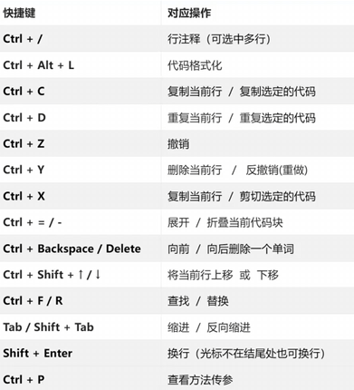
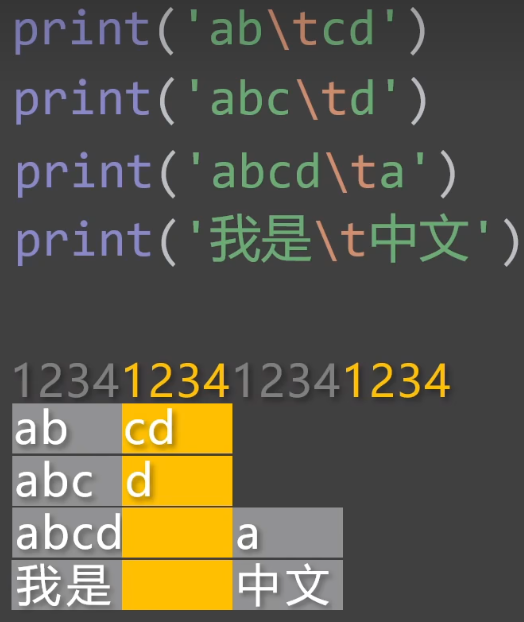

## PyCharm
### 快捷键

Ctrl+Shift+u 对选中的字符切换大小写
Ctrl+Alt+enter 在当前行的上一行插入空行
### 导入、导出PyCharm的设置
- 导出：`File` → `Manage IDE Settings` → **Export Settings…**，选择保存位置，输出文件为 `settings.zip`，点 OK 完成导出
- 导入：`File` → `Manage IDE Settings` → **Import Settings…**，选中 `settings.zip`，重启 PyCharm 生效
## 字面量
- 字面量，就是直接写在代码中具体值
- python的字符串中可以包含任意字符，且必须使用引号包起来
- 字符串的引号，可以是：单引号、双引号、三个单引号、三个双引号
- 写在python文件头部的字符串，会被自动识别docstring（文档字符串）
- docstring主要作用是：对当前python文件进行说明，必须使用三个双引号字符串
- 调整PyCharm的设置：检查代码、AI智能提示。
```python
"""文档字符串（docstring）写在开头，对当前python文件进行说明"""  
  
'张三'  
18  
65.2  
  
'''李四'''  
22  
74.5  
  
"王五"  
25  
80  
  
"""赵六"""  
34  
70  
  
print(25)  
print(74)
```
## 变量
- 在Python中，当一个新的变量出现时，它必须立即与某个值建立绑定关系。值：字面量、函数、类等等
- 变量名要遵守一定的命名规则
## 标识符
- 标识符，程序中所有我们自己起名的内容。（变量名、函数名、类名、模块名……）
- 命名规则
	- 只能包含：数字、字母、下划线，且不能以数字开头，不能包含空格
	- 标识符区分大小写，例如`Name`和`name`是两个不同的标识符
	- 标识符不能使用关键字
	- 标识符尽量不要与内置函数同名
	- 标识符虽然没有长度限制，但应追求：简洁清晰，具有描述性
```python
userName = 'dd' # lowerCamelCase 不推荐  
UserName = 'dd' # UpperCamelCase 类名  
user_name = 'dd' # snake_case 变量、函数、文件名  
MAX_VALUE = 100 # UPPER_SNAKE_CASE 常量
```
## 常量
- 常量，一旦被赋值，就不希望被修改的量（区别于变量）
- Python中一般约定使用全大写变量名来表示常量，涉及到多个单词时，用下划线做分隔
- Python中没有强制的常量机制，Python中所谓的常量，其本质还是变量，只不过我们约定好不去修改
## 注释
- 单行注释：# 后的一行内容
- 多行注释：使用==三个单引号==，或==三个双引号==，Python并没有真正的多行注释语法，本质是一个字符串字面量。
- 文件编码注释：写在Python文件开头，用于指定当前文件的字符编码。python3中可以不写，默认使用UTF-8
```Python
#coding=utf-8   
"""在该文件中，主要学习注释相关的内容"""  
  
'''  
下面是一些常量  
ADULT_AGE是法定成人年龄  
MONTH_IN_YEAR是一年中的几个月  
MAX_USERS是最大同时在线人数  
'''  
  
ADULT_AGE = 18  # 成人年龄
MONTH_IN_YEAR = 12  
MAX_USERS = 1200  
  
print(ADULT_AGE, MONTH_IN_YEAR, MAX_USERS)
```
## 字符编码
- ASCII => 大写字母、小写字母、数字、一些符号，共128个
- ISO 8859-1 => 在ASCII基础上，扩充了一些希腊字符等，共计256个
- GB2312 => 继续扩充，收录了6763个常用汉字、682个字符
- GBK => 收录了的汉字和符号达到20000+，支持繁体中文 
- utf-8又称万国码，全球语言通吃，可以对任意语言进行编码
```python
message1 = '你好'  
message2 = 'hello'  
message3 = 'สวัสดี'  
message4 = 'こんにちは'  
  
print(message1, message2, message3, message4)
```
## 数据类型
在Python中：变量无类型，数据有类型
### 整型
- 打印数字时，内部会把数字转换成字符串，再打印。Python中数字在转换字符串的过程中，默认限制是：数字不能超过4300位
```python
import sys  
  
# 所谓整型，就是没有小数点的数字，可以是正数，也可以是负数，也可以是0  
age = 18  
temp = -15  
score = 0  
  
# 当数很大时，我们可以使用下划线将数字进行分组，来让数字变得更易读  
salary = 300_000  
house_price = 3_200_000  
graduates = 12_000_000  
print(salary, house_price, graduates)  
  
# Python中整数的上限值，取决于执行代码的计算机的内存和处理能力  
a = 9 ** 9999  
sys.set_int_max_str_digits(0)  
print(a)
```
### 浮点型
```python
# 浮点型就是带有小数点的数字  
weight = 65.2  
balance = 242.3  
out_temp = -23.2  
price = 120.0  
  
# 浮点型的科学计数法表示  
speed_of_sound = 3.4e+2  # 3.4乘以10的2次方  
world_population = 7.8e9  # 7.8乘以10的9次方  
distance_sun_earth = 1.496E8  # 1.496乘以10的8次方  
speed_of_light = 2.998E+8  # 2.998乘以10的8次方  
  
one_ml = 1e-3  # 1乘以10的-3次方  
one_mg = 1E-3  
```
### 字符串
#### four ways to define a string 
```python
# 单引号和双引号的写法是等价的，二者都不能直接换行（要用圆括号才能换行），单引号用得多  
message1 = 'As long as you think it\'s right.'  
message2 = "As long as you think it's right."  
  
# 三个单引号，可以直接换行，（换行后回车也会打印出来）并且可以作为多行注释使用  
message3 = '''As long as you think it's right.'''  
  
# 三个双引号，可以直接换行，也可以作为多行注释使用，还能作为文档字符串使用。  
message4 = """As long as you think it's right."""
```
#### string formatting
- 按照预先定义的==格式==，将==变量==或==计算结果==，==插入==到字符串中并输出
```python
name = 'James'  
gender = 'male'  
weight = 56.3  
age = 20  
  
# 写法一：直接用加号进行拼接，写起来麻烦代码乱，并且只能字符串拼接  
info1 = 'My name is ' + name + '. I\'m ' + gender + '.'  
print(info1)  
  
# 写法二：使用占位符(%i占位整数，%d占位10进制的整数，%s是万能的)  
info2 = 'My name is %s. I am %s. My weight is %f kg and I am %i years old.' % (name, gender, weight, age) 
print(info2)  
  
# 写法三：使用f-string，是目前Python最推荐的方式  
info3 = f'我叫{name}，我是{gender}，我体重是{weight}，年龄是{age}'  
print(info3)
```
#### String placeholder precision control
- `%m.ns`
	- m
		- 字符串的==最小宽度==，位数==不够==会自动使用空格补全，位数==小于==字符串长度则==不起作用==
		- ==正数==是==右==对齐，==负数==是==左==对齐
	- n
		- ==精度==控制，==最多==输出==n个==字符（若==n大于==实际字符串长度，则不起作用）
- `%m.nf`
	- n：精度控制，保留n位小数（n的默认值为6），不够0来补，截断时会四舍五入
	- m
		- 控制整体宽度（整体宽度 = 整数宽度 + 小数点 + 小数宽度）
		- 位数不够空格来补，位数小于整体宽度，则自动失效
		- 正数是右对齐，负数是左对齐
- `m.nd`
	- m
		- 最小宽度，位数不够会使用空格补全，位数小于整数位数，则自动失效
		- 正数是右对齐，负数是左对齐
	- n
		- 精度控制，最少用n位显示数字
		- 位数不够用0来补，位数小于整数位，则自动失效 
```python
name = '张三'  
gender = '男'  
weight = 56.55  
age = 20  
info = '我叫%-4.1s,性别是%3.2s,体重是%9.3f,年龄是%6.4d' % (name, gender, weight, age)  
print(info)  # 我叫张   ,性别是  男,体重是   56.550,年龄是  0020
```
#### escape sequence
- 是一种在字符串中用于表示特殊含义的字符组合，通常以反斜杠开头，通常用于表示那些在字符串中不能直接写出的字符
- \t：水平制表符（让光标跳转到下一个制表位）
	- 
```python
# 使用 \' 输出 'print('在Python中，可以使用\'包裹一个字符串')  
  
# 使用 \" 输出 "print("在Python中，可以使用\"包裹一个字符串")  
  
# 使用 \n 进行换行  
print('注册会员需要以下信息：\n姓名\n年龄\n手机号')  
  
# 使用 \\ 输出 \print('D:\\nice')  
  
# 使用 \b 删除前一个字符，实现打印机效果  
print('helloo\b')  
  
# 使用 \r 使光标回到本行开头，覆盖输出， 实现进度加载效果  
print('67%\r68%')  
  
# 使用 \t 表示水平制表符（让光标跳转到下一个制表位）  
print('1234123412341234')  
# print('ab\tcd'.expandtabs(4))  
# print('abc\td'.expandtabs(4))  
# print('abcd\ta'.expandtabs(4))  
# print('我是\t中文'.expandtabs(4))  
  
print('ab\tcd')  
print('abc\td')  
print('abcd\ta')  
print('我是\t中文')
```
