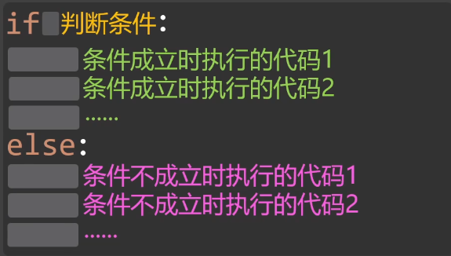
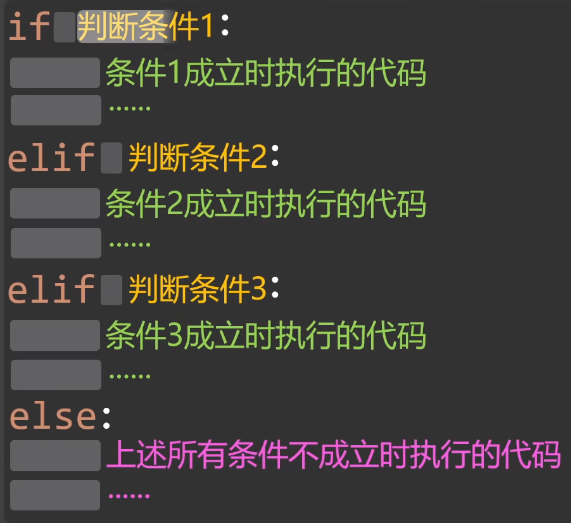
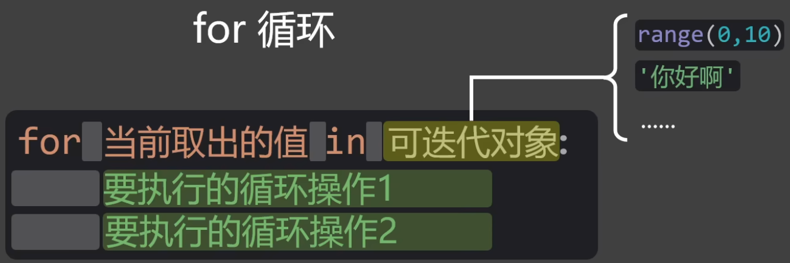
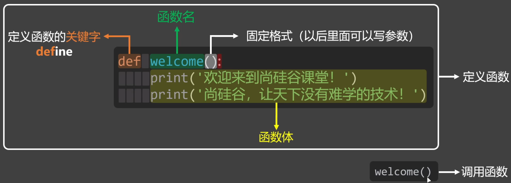
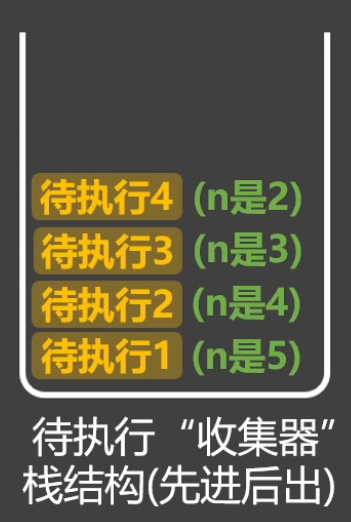
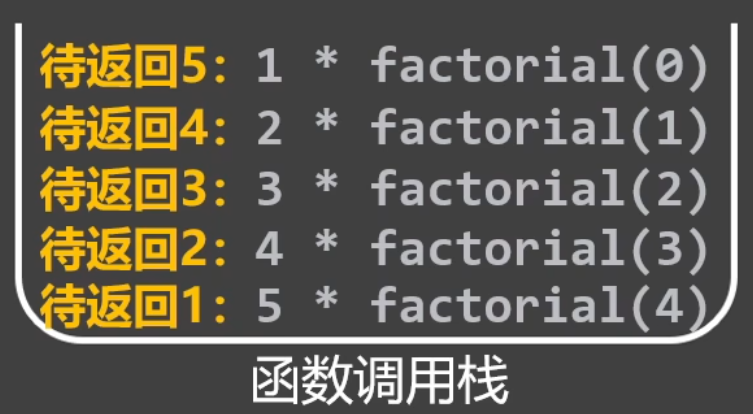

## PyCharm
### 快捷键

| 快捷键                       | 对应操作            |
| ------------------------- | --------------- |
| Ctrl + /                  | 行注释（可选中多行）      |
| Ctrl + Alt + L            | 代码格式化           |
| Ctrl + C                  | 复制当前行 / 复制选定的代码 |
| Ctrl + D                  | 重复当前行 / 重复选定的代码 |
| Ctrl + Z                  | 撤销              |
| Ctrl + Y                  | 删除当前行 / 反撤销(重做) |
| Ctrl + X                  | 复制当前行 / 剪切选定的代码 |
| Ctrl + = / -              | 展开 / 折叠当前代码块    |
| Ctrl + Backspace / Delete | 向前 / 向后删除一个单词   |
| Ctrl + Shift + ↑ / ↓      | 将当前行上移 或 下移     |
| Ctrl + F / R              | 查找 / 替换         |
| Tab / Shift + Tab         | 缩进 / 反向缩进       |
| Shift + Enter             | 换行（光标不在结尾处也可换行） |
| Ctrl + P                  | 查看方法传参          |
| Ctrl+Shift+U              | 对选中的字符切换大小写     |
| Ctrl+Alt+Enter            | 在当前行的上一行插入空行    |

### 导入、导出PyCharm的设置
- 导出：`File` → `Manage IDE Settings` → **Export Settings…**，选择保存位置，输出文件为 `settings.zip`，点 OK 完成导出
- 导入：`File` → `Manage IDE Settings` → **Import Settings…**，选中 `settings.zip`，重启 PyCharm 生效
## 字面量
- 字面量，就是直接写在代码中具体值
- python的字符串中可以包含任意字符，且必须使用引号包起来
- 字符串的引号，可以是：单引号、双引号、三个单引号、三个双引号
- 写在python文件头部的字符串，会被自动识别docstring（文档字符串）
- docstring主要作用是：对当前python文件进行说明，必须使用三个双引号字符串
- 调整PyCharm的设置：检查代码、AI智能提示。
```python
"""文档字符串（docstring）写在开头，对当前python文件进行说明"""  
  
'张三'  
18  
65.2  
  
'''李四'''  
22  
74.5  
  
"王五"  
25  
80  
  
"""赵六"""  
34  
70  
  
print(25)  
print(74)
```
## 变量
- 在Python中，当一个新的变量出现时，它必须立即与某个值建立绑定关系。值：字面量、函数、类等等
- 变量名要遵守一定的命名规则
## 标识符
- 标识符，程序中所有我们自己起名的内容。（变量名、函数名、类名、模块名……）
- 命名规则
	- 只能包含：数字、字母、下划线，且不能以数字开头，不能包含空格
	- 标识符区分大小写，例如`Name`和`name`是两个不同的标识符
	- 标识符不能使用关键字
	- 标识符尽量不要与内置函数同名
	- 标识符虽然没有长度限制，但应追求：简洁清晰，具有描述性
```python
userName = 'dd' # lowerCamelCase 不推荐  
UserName = 'dd' # UpperCamelCase 类名  
user_name = 'dd' # snake_case 变量、函数、文件名  
MAX_VALUE = 100 # UPPER_SNAKE_CASE 常量
```
## 常量
- 常量，一旦被赋值，就不希望被修改的量（区别于变量）
- Python中一般约定使用全大写变量名来表示常量，涉及到多个单词时，用下划线做分隔
- Python中没有强制的常量机制，Python中所谓的常量，其本质还是变量，只不过我们约定好不去修改
## 注释
- 单行注释：# 后的一行内容
- 多行注释：使用==三个单引号==，或==三个双引号==，Python并没有真正的多行注释语法，本质是一个字符串字面量。
- 文件编码注释：写在Python文件开头，用于指定当前文件的字符编码。python3中可以不写，默认使用UTF-8
```Python
#coding=utf-8   
"""在该文件中，主要学习注释相关的内容"""  
  
'''  
下面是一些常量  
ADULT_AGE是法定成人年龄  
MONTH_IN_YEAR是一年中的几个月  
MAX_USERS是最大同时在线人数  
'''  
  
ADULT_AGE = 18  # 成人年龄
MONTH_IN_YEAR = 12  
MAX_USERS = 1200  
  
print(ADULT_AGE, MONTH_IN_YEAR, MAX_USERS)
```
## 字符编码
- ASCII => 大写字母、小写字母、数字、一些符号，共128个
- ISO 8859-1 => 在ASCII基础上，扩充了一些希腊字符等，共计256个
- GB2312 => 继续扩充，收录了6763个常用汉字、682个字符
- GBK => 收录了的汉字和符号达到20000+，支持繁体中文 
- utf-8又称万国码，全球语言通吃，可以对任意语言进行编码
```python
message1 = '你好'  
message2 = 'hello'  
message3 = 'สวัสดี'  
message4 = 'こんにちは'  
  
print(message1, message2, message3, message4)
```
## 数据类型
在Python中：变量无类型，数据有类型
### 整型
- 打印数字时，内部会把数字转换成字符串，再打印。Python中数字在转换字符串的过程中，默认限制是：数字不能超过4300位
```python
import sys  
  
# 所谓整型，就是没有小数点的数字，可以是正数，也可以是负数，也可以是0  
age = 18  
temp = -15  
score = 0  
  
# 当数很大时，我们可以使用下划线将数字进行分组，来让数字变得更易读  
salary = 300_000  
house_price = 3_200_000  
graduates = 12_000_000  
print(salary, house_price, graduates)  
  
# Python中整数的上限值，取决于执行代码的计算机的内存和处理能力  
a = 9 ** 9999  
sys.set_int_max_str_digits(0)  
print(a)
```
### 浮点型
```python
# 浮点型就是带有小数点的数字  
weight = 65.2  
balance = 242.3  
out_temp = -23.2  
price = 120.0  
  
# 浮点型的科学计数法表示  
speed_of_sound = 3.4e+2  # 3.4乘以10的2次方  
world_population = 7.8e9  # 7.8乘以10的9次方  
distance_sun_earth = 1.496E8  # 1.496乘以10的8次方  
speed_of_light = 2.998E+8  # 2.998乘以10的8次方  
  
one_ml = 1e-3  # 1乘以10的-3次方  
one_mg = 1E-3  
```
### 字符串
#### four ways to define a string 
```python
# 单引号和双引号的写法是等价的，二者都不能直接换行（要用圆括号才能换行），单引号用得多  
message1 = 'As long as you think it\'s right.'  
message2 = "As long as you think it's right."  
  
# 三个单引号，可以直接换行，（换行后回车也会打印出来）并且可以作为多行注释使用  
message3 = '''As long as you think it's right.'''  
  
# 三个双引号，可以直接换行，也可以作为多行注释使用，还能作为文档字符串使用。  
message4 = """As long as you think it's right."""
```
#### string formatting
- 按照预先定义的==格式==，将==变量==或==计算结果==，==插入==到字符串中并输出
```python
name = 'James'  
gender = 'male'  
weight = 56.3  
age = 20  
  
# 写法一：直接用加号进行拼接，写起来麻烦代码乱，并且只能字符串拼接  
info1 = 'My name is ' + name + '. I\'m ' + gender + '.'  
print(info1)  
  
# 写法二：使用占位符(%i占位整数，%d占位10进制的整数，%s是万能的)  
info2 = 'My name is %s. I am %s. My weight is %f kg and I am %i years old.' % (name, gender, weight, age) 
print(info2)  
  
# 写法三：使用f-string，是目前Python最推荐的方式  
info3 = f'我叫{name}，我是{gender}，我体重是{weight}，年龄是{age}'  
print(info3)
```
#### String placeholder precision control
- `%m.ns`
	- m
		- 字符串的==最小宽度==，位数==不够==会自动使用空格补全，位数==小于==字符串长度则==不起作用==
		- ==正数==是==右==对齐，==负数==是==左==对齐
	- n
		- ==精度==控制，==最多==输出==n个==字符（若==n大于==实际字符串长度，则不起作用）
- `%m.nf`
	- n：精度控制，保留n位小数（n的默认值为6），不够0来补，截断时会四舍五入
	- m
		- 控制整体宽度（整体宽度 = 整数宽度 + 小数点 + 小数宽度）
		- 位数不够空格来补，位数小于整体宽度，则自动失效
		- 正数是右对齐，负数是左对齐
- `m.nd`
	- m
		- 最小宽度，位数不够会使用空格补全，位数小于整数位数，则自动失效
		- 正数是右对齐，负数是左对齐
	- n
		- 精度控制，最少用n位显示数字
		- 位数不够用0来补，位数小于整数位，则自动失效 
```python
name = '张三'  
gender = '男'  
weight = 56.55  
age = 20  
info = '我叫%-4.1s,性别是%3.2s,体重是%9.3f,年龄是%6.4d' % (name, gender, weight, age)  
print(info)  # 我叫张   ,性别是  男,体重是   56.550,年龄是  0020
```
#### escape sequence
- 是一种在字符串中用于表示特殊含义的字符组合，通常以反斜杠开头，通常用于表示那些在字符串中不能直接写出的字符
- \t：水平制表符（让光标跳转到下一个制表位）
	- 
```python
# 使用 \' 输出 'print('在Python中，可以使用\'包裹一个字符串')  
  
# 使用 \" 输出 "print("在Python中，可以使用\"包裹一个字符串")  
  
# 使用 \n 进行换行  
print('注册会员需要以下信息：\n姓名\n年龄\n手机号')  
  
# 使用 \\ 输出 \print('D:\\nice')  
  
# 使用 \b 删除前一个字符，实现打印机效果  
print('helloo\b')  
  
# 使用 \r 使光标回到本行开头，覆盖输出， 实现进度加载效果  
print('67%\r68%')  
  
# 使用 \t 表示水平制表符（让光标跳转到下一个制表位）  
print('1234123412341234')  
# print('ab\tcd'.expandtabs(4))  
# print('abc\td'.expandtabs(4))  
# print('abcd\ta'.expandtabs(4))  
# print('我是\t中文'.expandtabs(4))  
  
print('ab\tcd')  
print('abc\td')  
print('abcd\ta')  
print('我是\t中文')
```
### 布尔类型 boolean
`True` `False`
```python

```
## 数据类型转换
- 为什么要进行数据类型转换
	- 用户输入的内容是都是字符串，若需要进行数学运算，就必须进行数据类型转换。
	- 对文件进行写入操作时，要将其他类型的数据转为字符串。
	- 从数据库中读取出的内容都是字符串，若需要进行数学运算，也需要数据类型转换。
- 把指定数据转为字符串：`str()`
	- 任何类型都可以转成字符串类型
```python
# 使用str()将指定数据类型转换为字符串。  
result1 = str(18)  
result2 = str(75.6)  
result3 = str(1.8E3)  
result4 = str(12_000)
```
- 把指定数据转为整型：`int()`
```python
# 使用int()将指定数据类型转换为整型。  
result1 = int(15.6)  
result2 = int('79')  
result3 = int('   79   ')  
result4 = int(48)  
# 以下是错误示例  
# int('  7 9  ')  
# int('你好')  
# int('15.6')  #特别注意
```
- 把指定数据转为浮点型：`float()`
```python
# 使用float()将指定数据类型转换为浮点型。  
result1 = float(18)  
result2 = float('15.6')  
result3 = float('  5.7  ')  
result4 = float(14.8)  
result5 = float('89')  
  
# 以下是错误示例  
# float(' 5.  7 ')  
# float('你好')  
# float('5.23.534')
```
- 把指定内容转为布尔类型：`bool()`
```python
# 布尔类型是int类型的子类型，底层的本质是用1表示True，用0表示False  
print(int(True))  # 1  
print(int(False))  # 0  
  
# print(4 + True)  
# print(8 - False)  

# print(True + True)  
# print(True - False) 
 
# print(7 > True)  
# print(False <= 0)  
  
# 使用bool()将指定内容转为布尔类型  
print(bool(1))  # True  
print(bool(0))  # False  
  
# Python中除0以外的任何数，转为布尔值后都为True  
print(bool(300))  
print(bool(25.6))  
print(bool(1.8e3))  
print(bool(12_000))  
print(bool(-10))  # True  
  
# Python中除空字符串以外的任何字符串，转为布尔值都是True  
print(bool('hello'))  
print(bool('0'))  
print(bool('18.5'))  
print(bool('-9'))  
print(bool(''))  # False
```
## 运算符
### 算数运算符

| 运算符 | 说明      | 示例     | 结果  |
| --- | ------- | ------ | --- |
| +   | 加       | 9 + 7  | 16  |
| -   | 减       | 7 - 2  | 5   |
| *   | 乘       | 3 * 4  | 12  |
| /   | 除       | 9 / 6  | 1.5 |
| //  | 取整除（取整） | 9 // 6 | 1   |
| %   | 取余（取模）  | 9 % 6  | 3   |
| **  | 指数      | 2 ** 3 | 8   |
|     |         |        |     |
### 赋值运算符 & 复合赋值运算符

| 运算符 | 含义     | 示例            | 等价代码                   |
| --- | ------ | ------------- | ---------------------- |
| =   | 赋值运算   | age = 18      |                        |
| +=  | 加法赋值运算 | age += 1      | age = age + 1          |
| -=  | 减法赋值运算 | age -= 1      | age = age - 1          |
| *=  | 乘法赋值运算 | price *= 0.8  | price = price * 0.8    |
| /=  | 除法赋值运算 | pay /= 5      | pay = pay / 5          |
| //= | 取整赋值运算 | apple //= 14  | apple = apple // 14    |
| %=  | 取模赋值运算 | seconds %= 60 | seconds = seconds % 60 |
| **= | 指数赋值运算 | a **= b       | a = a ** b             |
### 比较运算符

| 运算符 | 作用           |
| --- | ------------ |
| ==  | 判断左右两侧是否相等   |
| !=  | 判断左右两侧是否不等   |
| >   | 判断左侧是否大于右侧   |
| <   | 判断左侧是否小于右侧   |
| >=  | 判断左侧是否大于等于右侧 |
| <=  | 判断左侧是否小于等于右侧 |
- Python中字符串进行比较时，是依次比较每个字符的Unicode编码。
- Unicode 编码不是Python特有的，而是全世界通用的标准。例如 `a` 的Unicode编码是97，`我`是25105
- Python中可以使用如下方式进行字符与Unicode编码之间的转化
	- 使用`ord()`查看Unicode 码
	- 使用`chr()`将Unicode 码转为字符
```python
# 使用ord()查看指定字符的Unicode编码  
print(ord('a'))  # 97  
print(ord('我'))  # 25105  
print(ord('中'))  # 20013  
  
# 使用chr()将Unicode编码转为字符  
print(chr(97))  
print(chr(25105))  
  
msg1 = 'abc'  
msg2 = 'xyz'  
msg3 = '我爱你'  
msg4 = '中国'  
msg5 = 'abc'  
msg6 = 'abcdef'  
print(msg1 == msg5)  # True  
print(msg1 < msg2)  # True  
print(msg3 > msg4)  
print(msg5 < msg6)
```
### 逻辑运算符

| 运算符 | 名称   | 功能描述                                   |
|--------|--------|--------------------------------------------|
| and    | 逻辑与 | 判断其两侧的值，是否都为True               |
| or     | 逻辑或 | 判断其两侧的值，是否至少有一个为True       |
| not    | 逻辑非 | 用于对一个值取反                           |
```python
# and具备"逻辑短路"能力  
print(False and 3 / 0)  # False  
print(3 > 9 and 3 / 0)  # False  
# print(True and 3 / 0)  # ZeroDivisionError  
  
# and返回的不一定是布尔值，它返回的是某个参与计算的值本身  
# 规则：and会先看左边，如果左边是“假”，就直接返回左边，否则返回右边  
# 备注：若参与and运算的值不是布尔值，那Python会自动转为布尔值，然后再进行逻辑操作  
print(2 - 2 and True)  # 0  
print('' and True)  # 空字符串  
print(True and 8 / 2)  # 4.0  
print(3 + 3 and 3 * 4)  # 12  
  
# or用于判断其两侧，是否至少有一个为True（只要有一个是True，那就返回True）  
# or同样具有“逻辑短路”的能力  
print(True or 3 / 0)  
  
# or返回的也不一定是布尔值，它返回的是参与计算的值本身  
# 规则：or会先看左边，如果左边为“真”，就直接返回左边，否则返回右边  
# 备注：若参与or运算的值不是布尔值，那Python会自动转为布尔值，然后再进行逻辑操作  
print(7 - 2 or False)  # 5  
print('你好' or '尚硅谷')  # 你好  
print(False or 8 / 2)  # 4.0  
print(2 - 2 or 3 * 4)  # 12  
  
# not用于取反  
# 备注：若参与not运算的值不是布尔值，那Python会自动转为布尔值，然后再进行逻辑操作  
# not返回的值，一定是布尔值!  
print(not 0)  # True  
print(not 3 > 2)  # False  
print(not 9 // 4)  # False  
print(not 'abc')  # False
```
## 进制
binary  octal  decimal  hexadecimal

| 写法      | 功能                   | 示例                                                                                                                |
| ------- | -------------------- | ----------------------------------------------------------------------------------------------------------------- |
| `bin()` | 将十进制整数转为二进制==字符串==   | `bin(25)` → `'0b11001'`                                                                                           |
| `oct()` | 将十进制整数转为八进制==字符串==   | `oct(540)` → `'0o1034'`                                                                                           |
| `hex()` | 将十进制整数转为十六进制==字符串==  | `hex(463)` → `'0x1cf'`                                                                                            |
| `int()` | 把其他进制数字字符串转十进制==整数== | 二进制转十进制：`int('0b11001',2)` →`25`<br><br>八进制转十进制：`int('0o1034',8)` →`540`<br><br>十六进制转十进制：`int('0x1cf',16)` →`463` |

```python
# 0b开头表示二进制  
num1 = 0b11001  
# 0o开头表示八进制  
num2 = 0o1034  
# 0x开头表示十六进制  
num3 = 0x1cf  
  
# Python 中所有的非十进制数字，只是代码层面的编写方式，是给程序员看的  
# Python在对上面的num1、num2、num3进行计算、打印等操作时，会自动将其转为十进制  
print(num1, num2, num3)  
print(num1 + 1)  # 26  
print(str(num2))  # 540  
print(num3 > 400)  # True  
  
# 使用bin()将十进制转为二进制  
result1 = bin(25)  
# 使用oct()将十进制转为八进制  
result2 = oct(540)  
# 使用hex()将十进制转为十六进制  
result3 = hex(463)  
# 注意：bin() oct() hex()他们返回的值类型都是字符串  
print(result1, result2, result3)  # 0b11001 0o1034 0x1cf  
print(type(result1), type(result2), type(result3))  # <class 'str'> <class 'str'> <class 'str'>  
  
# 使用int()将指定进制的数，转为十进制数字  
value1 = int('0b11001', 2)  
value2 = int('0o1034', 8)  
value3 = int('0x1cf', 16)  
print(value1, value2, value3)  # 25 540 463  
print(type(value1), type(value2), type(value3))  # <class 'int'> <class 'int'> <class 'int'>
```
## 输入语句
```python
# 使用input()获取用户的输入  
name = input('请输入你的姓名：')  
age = input('请输入你的年龄：')  
  
# input()获取到的内容全都是字符串类型  
print(type(age))  # <class 'str'>  
# 将age转为整型  
age = int(age)  
  
# 打印信息  
print(f'{name}，你今年的年龄是{age}')  
print(f'{name}，你明年的年龄是{age + 1}')
```
## 流程控制语句
### 顺序
### 分支
- 基于判断结果，来决定走哪条路径
#### 单分支
```python
age = int(input('Please enter your age: '))  
if age >= 18:  
    print("You are old enough to vote!")  
    print('你是成年人')  
print('欢迎你来学习Python！')
```
#### 双分支


```python
age = int(input('Please enter your age: '))  
if age >= 18:  
    print("You are old enough to vote!")  
    print('你是成年人')  
else:  
    print('你是未成年人')  
    print('好好加油')  
print('欢迎你来学习Python！')
```
#### 多分支


```python
age = int(input('请输入你的年龄：'))  
if age <= 10:  
    print('你是幼儿')  
elif age <= 18:  
    print('你是青少年')  
elif age <= 30:  
    print('你是青年')  
elif age <= 50:  
    print('你是中年')  
elif age <= 60:  
    print('你是中老年')  
else:  
    print('你是老年')
```
#### 嵌套分支
```python
age = int(input('请输入你的年龄：'))  
has_report = input('您是否提交了体检报告？（是/否）')  
level = int(input('请输入你的会员等级（1/2/3）'))  
  
print('****程序识别结果如下****')  
if 18 <= age <= 45:  
    print('您的年龄符合比赛要求！')  
    if has_report == '是':  
        print('您已提交体检报告！')  
        print('您可以参加比赛！')  
        if level == 1:  
            print(f'尊敬的{level}会员，比赛结束后，您可以领取纪念T恤')  
        elif level == 2:  
            print(f'尊敬的{level}会员，比赛结束后，您可以领取专业跑鞋')  
        elif level == 2:  
            print(f'尊敬的{level}会员，比赛结束后，您可以领取运动耳机')  
        else:  
            print('您输入的会员等级不正确！')  
    elif has_report == '否':  
        print('您未提交体检报告，不能参加比赛')  
    else:  
        print('您输入的体检报告有误！')  
else:  
    print('抱歉，参赛年龄需要在18~45之间！')
```

### 循环
#### while循环
```python
n = 1  
while n <= 10:  
    print(f'第{n}次')  
    n += 1  
print(f'while循环以外的代码，此时的n是{n}')  
  
print('您现在身处密室，正确回答问题后才能逃出密室！')  
riddle = '你是什么人？'  
answer = '循环'  
guess = ''  
  
while guess != answer:  
    print(f'问题：{riddle}')  
    guess = input('请输入答案：')  
    if guess == answer:  
        print('答案正确，逃脱成功！')  
    else:  
        print('回答错误，请再想想！')
```
#### for循环
- `range(10)`：表示循环范围，也是`range(0,10)`即`[0,10)` 

- 可迭代对象中的元素有多少个，循环就执行多少次
- 只要不在循环内部修改可迭代对象，for循环通常是不会出现死循环的
```python
# 使用for循环遍历range()所指定的数字范围  
for n in range(1, 11):  
    print(n)  
print(f'循环已结束，此时的n是：{n}');  
  
# 使用for循环遍历字符串  
for m in 'abcdef':  
    print(m)  
  
# 演示由于误操作造成的死循环
# 备注：for循环还能遍历很多我们没有讲到的东西，比如：元组、列表、对象……
nums = [1,2,3]  
for n in nums:  
    # nums.append(4)  
    print(n)

'''for循环案例'''  
#加密代码  
text = input('请输入加密文字：')  
secret = ''  
for t in text:  
    secret += chr(ord(t) + 1)  
print(f'经过加密后的内容：{secret}')  
  
# 解密代码  
secret = input('请输入解密文字：')  
text = ''  
for s in secret:  
    text += chr(ord(s) - 1)  
print(f'经过解密后的内容：{text}')
```
#### 对比while与for
- while
	- 条件驱动循环（只要条件为True就继续循环）
		- 写法灵活，尤其适合处理不确定循环次数的场景
		- 但需要手动维护循环条件，维护不好容易死循环
- for
	- 迭代驱动循环（遍历一个可迭代对象的每一项）
		- 语法简洁，处理可迭代对象的首选，不易发生死循环
		- 只适合一开始就知道要循环几次的场景
#### 嵌套循环
```python
# for循环实现  
day = 1  
for day in range(1, 31):  
    print(f'*******📅第{day}天******')  
    for group in range(1,4):  
        print(f'💪这是第{group}组仰卧起坐')  
    print(f'✅第{day}天任务完成！明天继续！ \n')  
print(f'🥳为期{day}天的健身计划完成，我的腹肌在闪闪发光！')  
  
# while循环实现  
day = 1  
while day <= 30:  
    print(f'*******📅第{day}天******')  
    group = 1  
    while group <= 3:  
        print(f'💪这是第{group}组仰卧起坐')  
        group += 1  
    print(f'✅第{day}天任务完成！明天继续！ \n')  
    day += 1  
print(f'🥳为期{day - 1}天的健身计划完成，我的腹肌在闪闪发光！')
```
- `print(输出内容, end="末尾字符")`,`end`：设置**打印内容结束之后，在末尾追加的字符**，默认值为`end="\n"`
- 定义变量的另一语法格式`q1, a1 = 'Python', 'hello'`
- ```python
  print("hello") 
  # 等价 
  print("hello", end="\n")
  
  '''九九乘法表'''  
	for n in range(1, 10):  
	    for m in range(1, n + 1):  
	        print(f'{m}*{n}={m * n}', end='\t')  
	    print()
  ```
#### continue与break
- continue：跳过本次循环剩余语句，随后进入下一次循环
- break：立即终止循环，不再执行后续循环
- continue和break在for循环和while循环中均可使用，在嵌套循环中出现时，只能作用在其所在的循环上
```python
# 测试continue  
# for day in range(1,5):  
#     print(f'******第{day}天******')  
#     print('吃饭')  
#     continue  
#     print('睡觉')  
  
for day in range(1, 5):  
    print(f'******第{day}天******')  
    print('吃饭')  
    for item in range(1, 3):  
        print(f'面包{item}')  
        if day == 4 and item == 2:  
            continue  
        print(f'牛奶{item}')  
    print('睡觉')  
  
# 测试break  
# for day in range(1,5):  
#     print(f'******第{day}天******')  
#     print('吃饭')  
#     break  
#     print('睡觉')  
  
for day in range(1, 5):  
    print(f'******第{day}天******')  
    print('吃饭')  
    for item in range(1, 3):  
        print(f'面包{item}')  
        if day == 3 and item == 2:  
            break  
        print(f'牛奶{item}')  
    print('睡觉')
```
## 函数
- 定义：组织好的、可重复使用的、用于执行特定任务的代码块
- 作用
	- 代码复用：提高代码复用性，减少重复代码
	- 结构清晰：让程序更易读、更易维护
	- 模块化开发：把程序分成若干个小功能，便于团队合作
- 分类
	- python中内置函数：https://docs.python.org/zh-cn/3.13/library/functions.html
	- python中的模块：https://docs.python.org/zh-cn/3.13/py-modindex.html

|分类|说明|举例|
|---|---|---|
|**内置函数**|无需要任何操作，直接就能使用。|`print()`、`type()`、`range()` ……|
|**模块提供的函数**|需要导入指定的模块后，才能使用。|`math.sqrt()`、`math.floor()`……|
|**自定义函数**|程序员自己定义的函数 (先定义再使用)。|具体写法，在下一小节讲解。|
### 基本使用

```python
# 定义函数  
def welcome():  
    print('jdjdjdj')  
    print('jdjdjdjjeeee')  
  
# 调用函数  
welcome()  
welcome()
```
### 参数的使用
- 形参num与dish的使用范围，仅限函数内
```python
def order(num, dish):  
    print(f'您点的是：{num}份{dish}')  
order(1, '辣椒炒肉')  
order(2, '番茄炒蛋')
```
#### 位置参数
- 位置参数：调用函数时，根据参数在函数定义中出现的顺序，把实参的值依次传递给对应的形参
- 注意：使用位置参数时，不能跳过某个位置的参数，去给后面的形参赋值
```python
# 定义函数（接收位置参数）  
def greet(name, gender, age, height):  
    print(f'我叫{name}, 性别{gender}, 年龄是{age}, 身高是{height}cm')  
# 调用函数  
greet('张三', '男', 18, 172)  
# 错误示例  
# greet('张三', 18, 172)
```
#### 关键字参数
- 关键字参数：调用函数时，通过`形参名=值`的形式传递实参
- 关键字参数是不挑顺序的
- 注意：混用位置参数时，**位置**参数必须在**关键字**参数**之前**
```python
# 定义函数  
def greet(name, gender, age, height):  
    print(f'我叫{name}, 性别{gender}, 年龄是{age}, 身高是{height}cm')  
  
# 调用函数（使用关键字参数）  
greet(name='张三', gender='男', age=18, height=172)  
greet(height=172, age=18, gender='男', name='张三')  
greet('张三', '男', height=172, age=18)  
  
# 错误示例  
# greet(height=172, age=18, '张三', '男')  
# greet(name='张三', '男', 18, 172)  
# greet(name='张三', '男', age=18, 172)  
# greet(height=172, age=18, gender='男', name='张三', age=19)  
# greet(height=172, age=18, gender='男', name='张三', school='尚硅谷')
```
#### 限制传参方式
- 具体规则：`/`前边只能使用位置参数，`*`后面只能使用关键字参数
- 注意：`/`和`*`同时使用时，`/`必须在`*`的 前面
```python
# 定义函数（使用/和*限制传参方式）  
def greet(name, /, gender, *, age, height):  
    print(f'我叫{name}, 性别{gender}, 年龄是{age}, 身高是{height}cm')  
  
# 正确示例  
greet('张三', '男', age=18, height=172)  
greet('张三', gender='男', age=18, height=172)  
  
# 错误示例  
# greet(name='张三', gender='男', age=18, height=172)  
# greet('张三', '男', 18, height=172)
```
#### 参数默认值
- 参数默认值：**定义**函数时，通过`形参名=值`的形式，为参数指定一个默认值
- 注意：默认参数必须要放在必选参数的后面，或者说：某个形参，一旦设置了默认值，那它后面的所有形参，也必须要写默认值
```python
# 定义函数（设置参数默认值）  
def greet(name, gender, age, height, msg='你好'):  
    print(f'我叫{name}, 性别{gender}, 年龄是{age}, 身高是{height}cm')  
    print(f'我想说: {msg}')  
  
# 调用函数  
greet('张三', '男', 18, 172)  
greet('张三', '男', 18, 172, 'hello')  
greet('张三', '男', 18, 172, msg='hello')  
  
# print函数底层给end参数设置了默认值  
print('尚硅谷', end='!!')
```
#### 可变参数
- 可变位置参数
	- 定义函数时，在形参名前加`*`，可以接收**任意数量**的**位置**参数，并打包成一个**元组**
- 可变关键字参数
	- 定义函数时，在形参名前加`**`，可以接收**任意数量**的**关键字**参数，并打包成一个**字典**
- 注意
	- 可变位置参数、可变关键字参数，可以同时使用，但必须先写可变位置参数
	- 可变位置参数、可变关键字参数，也能与其他类型的参数一起使用
```python
# 定义函数（使用*args去接收：可变位置参数）  
def test1(*args):  
    # 此处args的值，是一种新的数据类型，叫：元组  
    print(args)  
# 调用函数  
test1('张三', '男', 18, 172)  # ('张三', '男', 18, 172)  
  
# 定义函数（使用**kwargs去接收：可变关键字参数）  
def test2(**kwargs):  
    # 此处kwargs的值，是一种新的数据类型，叫：字典  
    print(kwargs)  
# 调用函数  
test2(name='张三', gender='男', age=18, height=172)  # {'name': '张三', 'gender': '男', 'age': 18, 'height': 172}  
  
# 定义函数（同时使用：可变位置参数、可变关键字参数）  
def test3(a, b, *args, c='开心', **kwargs):  
    print(a)  
    print(b)  
    print(args)  
    print(c)  
    print(kwargs)  
test3('张三', '男', '吃饭', '睡觉', c='哈哈哈', age=18, height=172)
```
### 特殊的字面量——None
- 目前已知的类型
	- 字符串类型（ str ）： `'hello' '尚硅谷' '100' '52.1' ……`
	- 整型（ int ）： `108 -256 12_000 200 ……`
	- 浮点型（ float ）： `14.5 1.8e3 -25.2 70.56 ……`
	- 布尔类型（bool）： `True False`
- NoneType 类型： `None`
	- None 是一个特殊的字面量，它表示：空值/无值/无意义。
		- 例如`msg = None`，定义了msg变量，但目前不知道它的类型
		- 不写None，写：`0`或`''`或`False`不行吗？——最好别写
		- None更中立，更开放，None不暗示类型
		- 如果确定msg以后是字符串类型，那就可以写`''`
	- None 的类型是 NoneType
	- None 转为布尔值值是False
	- None 不能参与数学运算，也不能与字符串拼接
	- 不给函数设置返回值，函数会默认返回None
```python
# None是一个特殊的字面量，它表示：空值 / 无值 / 无意义。  
msg = None  
  
# None 的类型是 NoneType。  
print(type(msg))  # <class 'NoneType'>  
  
# None 转为布尔值是 False。  
print(bool(msg))  
if not msg:  
    print('你好')  
  
# 不能参与数学运算，也不能与字符串拼接。  
# result1 = msg + 1  
# result1 = msg + 'hello'
```
### 返回值
- 函数执行完毕后，会把执行结果交给调用者，这个执行结果就是返回值
- return 关键字：return 会结束函数执行，并把return后的值，作为函数的返回值
```python
def add(n1, n2):  
    print(f'我收到了：{n1}、{n2}, 二者相加是：{n1 + n2}')  
    return n1 + n2  
  
result = add(100, 333)  
print(result)  
  
res = print('hello')  
print(res)  # None
```
### 全局作用域和局部作用域
不止这两种，此处先将这两种
- 全局作用域：整个`.py`文件最外层为范围，就是全局作用域
	- 全局变量：在当前文件的任意位置都能使用
- 局部作用域：函数的内部范围，就是局部作用域
	- 局部变量：只能在当前局部作用域中使用
- 局部作用域和局部变量，会在函数**调用时创建**，在函数**执行结束后销毁**
- 全局作用域和全局变量，会在程序开始时创建，在程序结束后销毁
```python
# 局部作用域 和 局部变量，会在函数调用时创建，在函数执行结束后自动销毁  
def test2():  
    m = 100  
    m += 1  
    print(f'我是test2函数中打印的m: {m}')  
  
test2()  # 101  
test2()  # 101  
test2()  # 101  
  
# 全局作用域和全局变量，会在程序开始时创建，在程序结束后销毁  
n = 100  
def test3():  
    global n  
    n += 1  
    print(f'我是test3函数打印的n: {n}')  
test3()  # 101  
test3()  # 102  
test3()  # 103
```
- global
	- `global 变量名` 写在函数内部，**声明这个名字使用全局变量**；**本函数内该名字全部绑定全局，不能再生成局部同名变量**。
	- 一旦`global a`，整个函数里所有`a`读、写都是全局。**同一个函数不能同时拥有局部 a 和全局 a**。
	- 函数里可以**读取全局变量**（例子中的 b），不修改的情况下不需要 global；只有**想要在函数内部修改全局变量的值**，才需要 global。
```python
# 全局作用域 与 局部作用域，以及global的使用  
a = 100  
b = 200  
  
def test():  
    c = '尚硅谷'  
    d = '你好啊'  
    global a  
    a = 300  
    print('函数中的打印(a) ', a)  
    print('函数中的打印(b) ', b)  
    print('函数中的打印(c) ', c)  
    print('函数中的打印(d) ', d)  
  
test()  
print('****************')  
print('全局的打印(a) ', a)  
print('全局的打印(b) ', b)  
# print(c)  
# print(d)
```
### 嵌套调用
- 在一个函数的执行过程中，去调用了另外一个函数
- 定义函数的时候，Python不会执行函数体中的代码，调用的时候才会
```python
def test1():  
    print('进入 test1 函数')  
    test2()  
    print('退出 test1 函数')  
  
def test2():  
    print('进入 test2 函数')  
    test3()  
    print('退出 test2 函数')  
  
def test3():  
    print('进入 test3 函数')  
    print('***正在执行 test3 函数')  
    print('退出 test3 函数')  
  
test1()
```
```plaintext
进入 test1 函数  
进入 test2 函数  
进入 test3 函数  
***正在执行 test3 函数  
退出 test3 函数  
退出 test2 函数  
退出 test1 函数
```
### 递归调用
- 函数自己调用自己的一种操作
- 特别注意：这两段代码在递归时，其实都需要逐层压栈，二者调用深度完全相同，只是打印的时机不同。
- 我们之前说 “待执行收集器” 只是为了大家好理解，其实最准确的说法，其实应该叫：**函数调用栈**。
- 每一次递归调用，都会在调用栈里压入对应的信息，因此递归必然涉及到：**多次压栈和出栈**。
```python
# 使用递归打印n次“你好啊”（从大到小）  
def welcome(n):  
    print(f'你好啊{n}')  
    if n > 1:  
        welcome(n - 1)  
welcome(5)  
  
print('***************')  
# 使用递归打印n次“你好啊”（从小到大）  
def welcome1(n):  
    if n > 1:  
        welcome1(n - 1)  
    print(f'你好啊{n}')  
welcome1(5)
```

- 递归的应用：把一个很大的事，拆解成无数个套路**一样**的小事

```python
# 使用递归求阶乘  
def factorial(num):  
    if num == 0:  
        return 1  
    else:  
        return num * factorial(num-1)  
result = factorial(5)  
print(result)
```

### 函数·说明文档
- 说明文档：写在函数里的文字说明，用来描述：函数的功能、需要哪些参数、返回什么结果
```python
def add(a, b):  
    """  
    计算两个数相加的结果  
    :param a: 第一个数  
    :param b: 第二个数  
    :return: 二者相加的结果  
    """    return a + b  
result = add(1, 2)
```
## 数据容器
- 数据容器：一种能存放多个数据的数据类型
- 数据容器可以更高效的管理成批的数据，且便于存储、访问
	- 容器中的每一个数据，又称：每一个元素
	- Python中有很多种数据容器
		- 列表（list）、元组（tuple）、字符串（str）、集合（set）、字典（dict）
	- 不同的数据容器，有不同的特点，和不同的语法，但都有一个共性，就是都可以存储多个元素
### 列表
#### 定义列表
- 定义空列表：列表中的数据，后期会通过特定写法填充
```python
# 定义有内容的列表  
list1 = [34, 54, 65, 243]  
list2 = ['北京', 'shide']  
list3 = [23, 'beijing', True, None]  
list4 = [23, 'beijing', True, None, [100, 343, 'good']]  
  
# 定义空列表（列表中的数据，后期会通过特定写法填充）  
list5 = []  
list6 = list()
```
#### 下标（索引值）
- 下标（索引值）：列表中元素的位置编号
	- 正索引：从左往右数，其实元素是0，随后是1，依次类推。
	- 负索引：从右往左数，其实元素是-1，随后是-2，依次类推
- 通过`列表[下标]`的形式，取出对应元素
```python
nums = [10, 20, 30, 40, 50]  
  
# 测试正索引  
print(nums[0])  
print(nums[1])  
print(nums[2])  
print(nums[3])  
print(nums[4])  
  
# 测试负索引  
print(nums[-1])  
print(nums[-2])  
print(nums[-3])  
print(nums[-4])  
print(nums[-5])  
  
# 测试错误索引  
# print(nums[5])  
  
# 定义一个嵌套列表  
nums2 = [10, 20, ['你好啊', '我不好'], 40, 50]  
# 取出“我不好”  
print(nums2[2][1])
```
#### 增删改查（CRUD）
| 操作     | 写法                  | 作用                      |
| ------ | ------------------- | ----------------------- |
| **新增** | `列表.append (元素)`    | 在列表尾部追加一个元素。            |
|        | `列表.insert (下标，元素)` | 在列表指定下标处添加一个元素。         |
|        | `列表.extend (可迭代对象)` | 将可迭代对象中的内容依次取出，追加到列表尾部。 |
| **删除** | `列表.pop (下标)`       | 删除指定位置的元素，并将删除的元素返回。    |
|        | `列表.remove (值)`     | 删除列表第一次出现的指定值。          |
|        | `列表.clear ()`       | 删除列表中的所有元素（清空列表）。       |
|        | `del 列表 [下标]`       | 删除指定位置的元素。              |
| **修改** | `列表 [下标] = 值`       | 通过下标修改指定位置的元素。          |
| **查询** | `列表 [下标]`           | 通过下标获取指定位置的元素。          |
- 方法vs函数：当一个函数隶属于某个对象时，那该函数就是对该对象的一个方法
	- `b()`调用b函数，`a.b()`调用a的b方法
- 新增
	- 可迭代对象：`'天气好'  range(1,4)  [70,80,90]`。
```python
# 方式一：通过列表的append方法，在列表尾部追加一个元素  
nums = [10, 20, 30, 40]  
nums.append(50)  
print(nums)  
  
# 方式二：通过列表的insert方法，在列表的指定下标处添加一个元素 
nums = [10, 20, 30, 40]  
nums.insert(2, 666)  
print(nums)  
  
# 方式三：通过列表的extend方法，将可迭代对象中的内容依次取出，追加到列表尾部  
nums = [10, 20, 30, 40]  
nums.extend('天气好')  
nums.extend(range(1,4))  
nums.extend([70, 80, 90])  
print(nums)  # [10, 20, 30, 40, '天', '气', '好', 1, 2, 3, 70, 80, 90]
```
- 删除
```python
# 方式一：通过列表的pop方法，删除指定位置的元素，并返回该元素  
nums = [10, 20, 30, 40, 50]  
result = nums.pop(1)  
print(nums)  # [10, 30, 40, 50]  
print(result)  # 20  
  
# 方式二：通过列表的remove方法，删除列表中第一次出现的特定值  
nums = [10, 20, 10, 40, 50]  
nums.remove(10)  
print(nums)  # [20, 10, 40, 50]  
  
# 方式三：通过列表的clear方法，删除列表中所有的元素（清空列表）  
nums = [10, 20, 30, 40, 50]  
nums.clear()  
print(nums)  # []  
  
# 方式四：通过del关键字，删除指定元素  
nums = [10, 20, 30, 40, 50]  
del nums[3]  
print(nums)
```
- 修改
```python
nums = [10, 20, 30, 40]
nums[2] = 66
```
- 查询
```python
nums = [10, 20, 30, 40]
print(nums[3])
```
#### 常用方法
| 写法                        | 作用                                             | 返回值     |
| ------------------------- | ---------------------------------------------- | ------- |
| `列表.index (值)`            | 查找指定元素在列表中**第一次出现**的下标。                        | 元素下标    |
| `列表.count (值)`            | 统计某个元素在列表中**出现的次数**。                           | 元素出现的次数 |
| `列表.reverse ()`           | **反转列表**，无需参数，直接操作原列表。                         | 无       |
| `列表.sort (reverse = 布尔值)` | 对列表**排序**（默认从小到大排列），会改变原列表，reverse 参数用于控制排序方式。 | 无       |
```python
# 1.使用 index 方法，查找指定元素在列表中第一次出现的下标，返回值是：元素下标。  
fruits = ['香蕉', '苹果', '橙子', '香蕉']  
result = fruits.index('香蕉')  
print(result)  # 0  
  
# 2.使用 count 方法，统计某个元素在列表中出现的次数，返回值是：元素出现的次数。  
nums = [10, 20, 10, 30, 10, 40, [10, 10, 10]]  
result = nums.count(10)  
print(result)  # 3  
  
# 3.使用 reverse 方法，对列表进行反转（会改变原列表）。  
nums = [23, 11, 32, 30, 17]  
nums.reverse()  
print(nums)  # [17, 30, 32, 11, 23]  
  
# 4.使用 sort 方法，对列表排序（默认从小到大），若想从大到小，可以将 reverse 参数设为True。  
# 4.1 若列表中的元素：都是数字，则按照数字的大小顺序进行排序。  
nums = [23, 11, 32, 30, 17]  
nums.sort(reverse=True)  
print(nums)  # [32, 30, 23, 17, 11]  
  
# 4.2 若列表中的元素：既有数字，又有字符串，那就会报错。  
# nums = [23, 11, 32, 30, 17, '尚硅谷']  
# nums.sort()  
# print(nums)  
  
# 4.3 若列表中的元素：都是字符串，则按照字符串的 Unicode 编码大小进行排序  
msg_list = ['北京', '北硅谷', '北好']  
msg_list.sort()  
print(msg_list)  
print(ord('京'), ord('好'), ord('硅'))  # 20140 22909 30789  
  
# 备注：所有的列表方法，都只作用于“当前层”的元素（浅层操作），不会自动进入嵌套的“里层”结构中。
```
#### 常用内置函数
本小节所讲的内置函数，适用于：**所有的数据容器**

| 操作       | 写法                          | 作用                                              | 返回值     |
| -------- | --------------------------- | ----------------------------------------------- | ------- |
| **内置函数** | `sorted(数据容器, reverse=布尔值)` | 对容器排序（默认从小到大排列），**不会改变原列表**，reverse 参数用于控制排序方式。 | 排序后的新容器 |
|          | `len(数据容器)`                 | 获取容器中元素的总数量。                                    | 元素总数量   |
|          | `max(数据容器)`                 | 获取容器中的最大值。                                      | 最大值     |
|          | `min(数据容器)`                 | 获取容器中的最小值。                                      | 最小值     |
|          | `sum(数据容器)` ⚠️字符串不能使用 sum   | 获取容器中所有元素的和。                                    | 所有元素的和  |
```python
# 1.使用内置的 sorted 函数，返回一个排序后的新容器（不改变原容器，默认顺序：从小到大）  
# 1.1 若列容器中的元素：都是数字，则按照数字的大小顺序进行排序。  
nums = [23, 11, 32, 30, 17]  
result = sorted(nums, reverse=True)  
print(nums)  # [23, 11, 32, 30, 17]  
print(result)  # [32, 30, 23, 17, 11]  
  
# 1.2 若列容器中的元素：既有数字，又有字符串，那就会报错。  
# nums = [23, 11, 32, 30, 17, '尚硅谷']  
# sorted(nums)  
  
# 1.3 若列容器中的元素：都是字符串，则按照字符串的 Unicode 编码大小进行排序。  
msg_list = ['北京', '尚硅谷', '你好']  
result = sorted(msg_list)  
print(msg_list)  # ['北京', '尚硅谷', '你好']  
print(result)  # ['你好', '北京', '尚硅谷']  
  
# 2.使用内置的 len 函数，获取容器中元素的总数量，返回值是：元素总数量。  
nums = [10, 20, 10, 30, 10, 40, [50, 60, 70]]  
result = len(nums)  
print(result)  # 7  
  
# 3.使用内置的 max 函数，获取容器中的最大值，返回值是：最大值。  
# 3.1 如果容器中的元素：都是数字，那 max 返回的是最大的数。  
nums = [23, 11, 32, 30, 17]  
result = max(nums)  
print(nums)  # [23, 11, 32, 30, 17]  
print(result)  # 32  
  
# 3.2 如果容器中的元素：既有数字又有字符串，那 max 会报错。  
# nums = [23, 11, 32, 30, 17, '尚硅谷']  
# max(nums)  
  
# 3.3 如果容器中的元素：都是字符串，那 max 会返回：Unicode 编码最大的字符。  
msg_list = ['北京', '尚硅谷', '你好']  
result = max(msg_list)  
print(msg_list)  # ['北京', '尚硅谷', '你好']  
print(result)  # 尚硅谷  
  
# 3.4 max 函数也可以接收多个值，并筛选出最大值  
result = max(33, 45, 12, 78, 99)  
print(result)  # 99  
  
# 4.使用内置的 min 函数，获取容器中的最小值，返回值是：最小值。  
# 备注: min 函数的使用方式与注意点与 max 函数一样，只不过 min 函数返回的是最小值  
nums = [23, 11, 32, 30, 17]  
result = min(nums)  
print(result)  # 11  
  
# 5.使用内置的 sum 函数，对容器中的数据进行求和 (元素只能是数值)。  
nums = [10, 20, 30, 40, 50]  
result = sum(nums)  
print(result)  # 150
```
#### 循环遍历
- 遍历：把容器中的元素依次取出，并对它们进行处理的过程。
	- while循环
	- for循环
```python
# 定义一个成绩列表  
score_list = [62, 50, 60, 48, 80, 20, 95]  
  
# 使用while循环遍历列表  
index = 0  
while index < len(score_list):  
    print(score_list[index])  
    index += 1  
  
# 使用for循环遍历列表（通过range函数 和 len函数按照索引遍历）  
for index in range(len(score_list)):  
    print(score_list[index])  
  
# 使用for循环遍历列表（通过enumerate函数，同时获取下标（索引值）和元素）  
# enumerate 的 start 参数, 可以让计数从指定值开始（改变的是循环时的“编号”，不是真正的索引值）  
for index, item in enumerate(score_list, start=5):  
    print(index, item, score_list[0])  
print('最后的打印', score_list[0])  
'''  
5 62 62  
6 50 62  
7 60 62  
8 48 62  
9 80 62  
10 20 62  
11 95 62  
'''
```
- 列表总结
	- 可存放不同类型的元素。
	- 元素是有序存储的(正索引、负索引)。
	- 列表中的元素允许重复。
	- 元素是允许修改的(增、删、改、查、其他操作)。
	- 长度不固定，可以随着操作自动调整大小。
- 列表是最常用的数据容器，当遇到要“存储一批数据”的场景时，首选列表。