#  chapter2 
+ ROS=通信架构+工具+功能+生态系统，用于编写机器人软件的灵活框架

## ROS通信结构
+  ROS 虽然名为 “操作系统”，但是它和 Ubuntu 这一类操作系统是不同的，ROS 不是传统意义上的操作系统，不用于进程管理和调度，而是构建在其他操作系统之上的一种结构化通信层 。 
+ **OS 层**：OS 层是操作系统层，也就是本书中使用的 Ubuntu，该层对 ROS 开发来说不需要过多了解，能够熟练地使用第 1 章中介绍的 Ubuntu 基本操作即可。 
+  **中间层**：中间层有 TCPROS/UDPROS、Nodelet API、Client Library，是 ROS 中最基础的几个组件。TCPROS/UDPROS 是基于 TCP/IP 做的二次封装，取名为 TCPROS 和 UDPROS。Nodelet API 为了弥补 TCPROS/UDPROS 的一些不足，使用了一种共享内存而不是网络传输的方法实现一些数据的共享，降低了网络传输的带宽需求，Client Library 是客户端的库，这个库中把 UDPROS 和 TCPROS 继续进行封装，形成了一些 ROS 的具体通信实现方法，如后文中的话题、服务等。   
    - TCP/IP 是互联网通信的“通用规则”，而 TCPROS 和 UDPROS 是专门为机器人操作系统（ROS）设计的、基于这套规则定制的两种具体“通信方式”。
    - TCPROS 的可靠代价：当网络繁忙时，TCPROS 为了保证可靠传输，会启动“反压”机制，让发送方慢下来。如果数据积压太多，超出队列缓存，消息依然会在发送端被丢弃。但这属于流量控制，而非网络传输中丢失。
    - UDPROS 的应用场景：因为在遥控操作等场景中，过时的数据比没有数据更糟糕。例如，一个延迟的“左转”指令可能会造成危险，所以宁可丢掉旧的指令，也要确保最新的指令能以最低延迟到达。
    - ROS 2 的进化：值得一提的是，在 ROS 2 中，通信机制已经全面升级为基于 DDS（数据分发服务） 的架构，它提供了更丰富的通信质量和可靠性选项，但底层依然基于 TCP/IP 协议<
+ 应用层：应用层的最左边是一个主节点，主节点是与中间层一起框起来，上面标注了一个 ROS。这是因为主节点是每一个 ROS 运行中必须要有，且只能唯一有的。所以说主节点也是 ROS 官方提供的，它用来管理右边这些应用层的节点（Node）。而每一个节点就是一个相互独立的应用，也就是前面提到的一个个独立的功能模块。
+ 可以归纳一下，ROS 的通信是在 OS 层之上，基于 TCP/IP 和客户端库的二次封装实现的一套通信体系。

### 节点与主节点
+ 节点是一个可执行程序进程，通常一个节点负责机器人的某一个单独的功能。不同的节点可以使用不同的编程语言，各个节点也可以运行在不同的设备上，例如摄像头驱动和图像处理节点运行在车载计算机上，而图像显示节点运行在笔记本计算机上
+ 主节点的工作：相互独立的节点需要一个统一的接口来管理，使他们互相知道彼此的存在并可以交换数据。相当于管理中心，每一个节点启动的时候先要在主节点处进行一次注册（Registration），告诉主节点自己的基本信息，需要接受什么样的信息、发布什么样的信息。节点间通信需要先由主节点进行“牵线”，然后才能进行两两之间的点对点通信。
+ 节点与节点之间的通信共4种实现方式：Topic话题、Service服务、Action动作、Paramiters参数

### Topic
+ 发布者和订阅者之间传递的是Topic话题，话题的内容称为Message消息
+ 不保证通信质量，即
    - 发布者不知道发布的话题有没有被收到
    - 订阅者收到的话题也不知道是谁发布的
    - 发布的时间（虽然有些消息类型包含时间戳信息，但是话题通信机制是不保证实时性的）
+ 单向的、多对多（但一般人们会一对多）
+ 多用于数据发布，例如摄像头数据通过话题通信方式发布
+ Service
+ Service包含两部分信息，Request请求和Response应答
+ 有条件的双向，通信只能由客户端发起，多（客户端）对一（服务器）
+ 应用于逻辑处理、任务执行周期短的情况下
+ 客户端发送一个请求，服务端返回一个应答

### Action
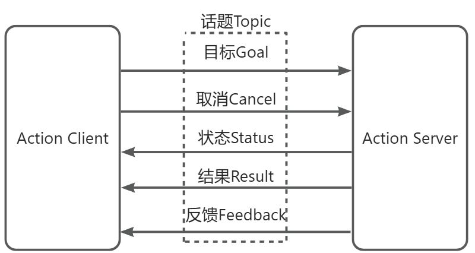

+ 通信双方称为Action Client和Action Server，传递的内容是话题，动作通信的底层是使用话题实现的
+  动作通信的过程是，由客户端向服务端发送目标（Goal），服务端在收到消息后开始执行，在执行期间可以向客户端发送若干次执行过程的反馈（Feedback），也可以为执行的过程设置一些状态位，例如开始执行，执行到第一步、第二步等，这个状态就可以通过状态（Status）发送给客户端。在执行的过程中客户端可以向服务端发送取消（Cancel）的指令，服务端执行完成后会向客户端发送执行结果（Result）  
+  这个过程和前面介绍的服务通信有点类似，区别在于动作通信方式的服务端在执行动作的过程中可以向客户端发送 0 次至多次的反馈信息，另外服务端在执行动作的过程中会订阅动作的取消话题，如果发布取消话题，服务端会停止执行当前动作中的剩余部分  
+  动作通信是基于话题通信的发布订阅模型做了一层封装，通过多个话题实现双向多次通信。用户也可以自己通过话题实现动作的效果

### 参数服务器
+ 一种比较特殊的机制，由ROS提供，随着roscore一起启动，不需要用户来编写和启动
+ 本质是一个字典，以key-value形式存储。用于配置参数，参数服务器种的参数全局共享，ROS网络中所有节点都可以设置和获取参数服务器中参数对应的值，通过命令或者在节点中通过参数编程接口
+ 适用于一些需要动态调节的参数，例如在机器人导航中，想要调节导航中的参数来观察移动效果，就可以用参数服务器来存储和调节参数的值，这样比设置参数→运行→停止→调整参数→再运行要方便多

## ROS常用shell命令
+ roscore启动主节点、一些必要的日志输出、参数服务器
- tf变化调试工具：rqt_tf_tree，使用`rosrun rqt_tf_tree rqt_tf_tree`


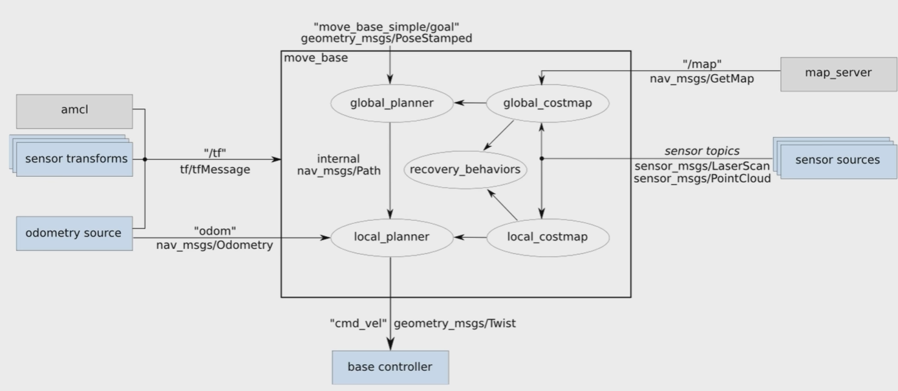
地图分层
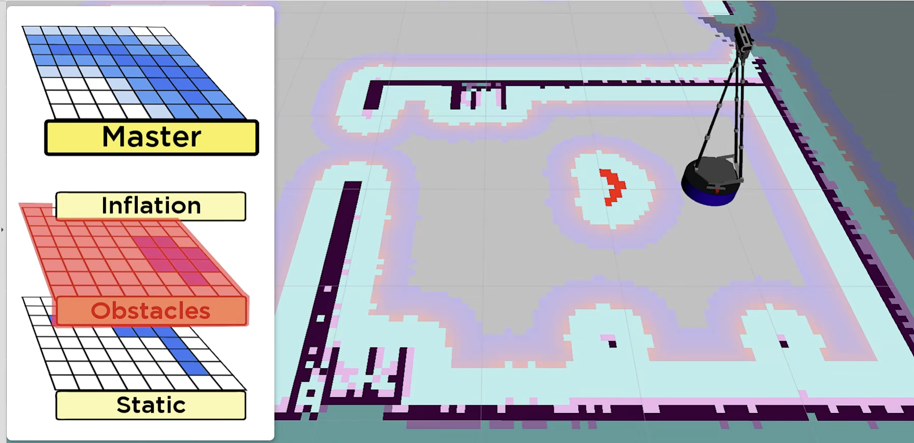
- 重置行为：不是因为扫不到，而是我们手动设置的参数把机器人0米以外的障碍消除了，近处障碍物还保留是因为在消除后的一瞬间，机器人又扫描到了，所以近处障碍物保留。相当于将看不到的地方恢复为mapserver加载的地图
- 旋转清除和重置行为的参数，分别搜索rotate_recovery和clear_costmap_recovery
- clear_costmap_recovery重置行为的layer_names参数的默认值为obstacles，但是在costmap_2d的代码中默认的障碍物层名字是obstacle_layer
- 所以需要从一下代码中选一种进行更改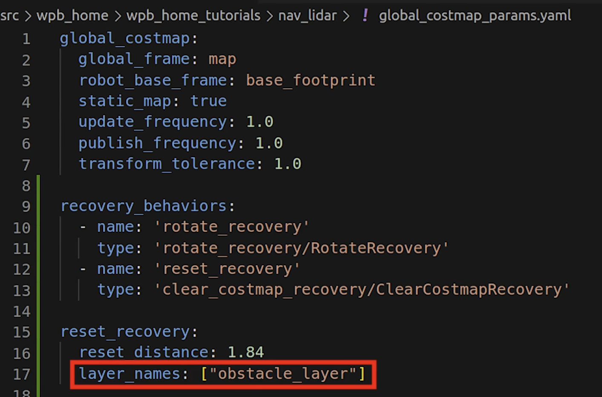
- 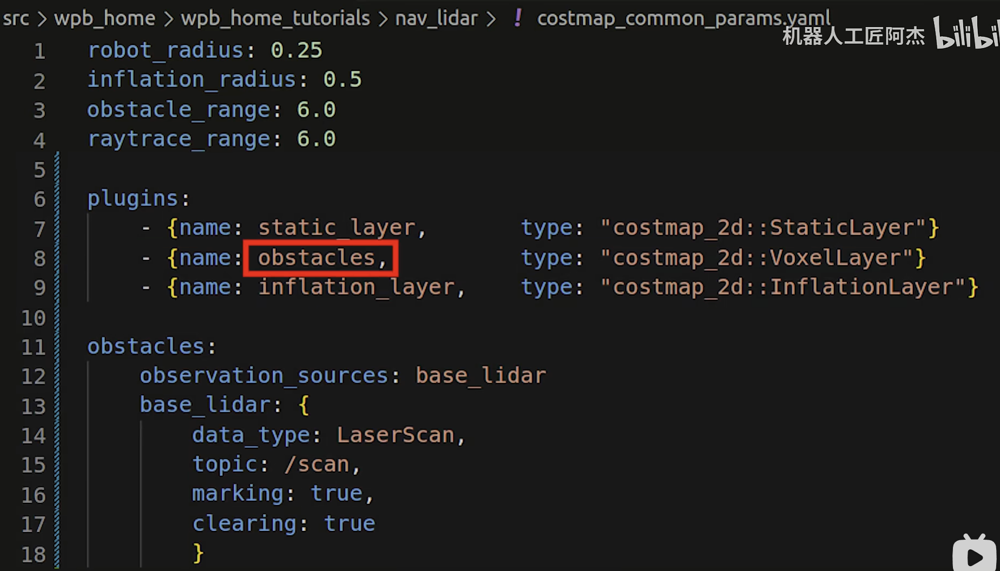
- 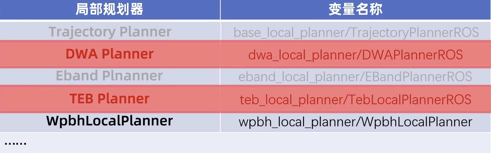
- DWA规划器：Dynamic Window Approach 动态窗口方法，窗口是指线路轨迹和运动速度的可选择空间
	- 参数说明，ros index网站里搜素dwa，`rosrun rqt_reconfigure rqt_reconfigure`,运行后弹出窗口，左侧可以看到所有支持动态调参的项目列表，调出完美参数后，可以把调整后的结果写到参数文件里保存
	- min_vel_x：最小X方向速度，如果设置为大于等于0的值，机器人就只能前进，不能倒退。比如在这样的死胡同里不能倒车，就有可能卡住出不来了。当把这个最小速度设置为负值的时候。他就会往后倒一下，这就能够脱困了。它是这种倒车动作，只适合激光雷达，能扫到后面的机器人。如果机器人身后没有雷达的视野，则需要慎重考虑，否则容易撞到身后或者侧面的障碍物。当然，尽量避免机器人进入这种危险属性
- TEB规划器：Timed Elastic Band 时间弹力带，适合阿克曼底盘不能原地旋转的机器人，小车竞速，如果机器人后方没有雷达视野，就需要谨慎选择teb规划器，否则倒车过程中季容易与背面和侧面的障碍物发生碰撞
	- 详细参数，ros index网站搜索teb


## 自制局部规划器
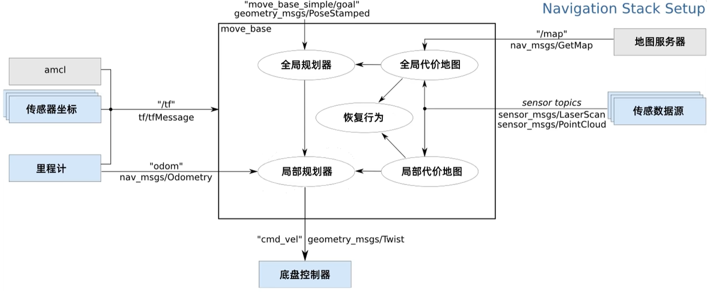
- ROS插件需要具备的条件
	- 从插件始祖类进行继承
	- 遵循定义好的函数接口
### 创建规划器框架
- 确定规划器名称
- 创建软件包
```bash
cd ~/catkin_ws/src/
catkin_create_pkg my_planner roscpp pluginlib nav_ccore
```
- 编写规划器的h头文件和cpp源码文件
- CMakeLists.txt添加编译规则
- 编写插件描述xml文件
- CMakeLists.txt 添加描述文件安装规则
- package.xml 添加插件描述文件地址
- 编译软件包
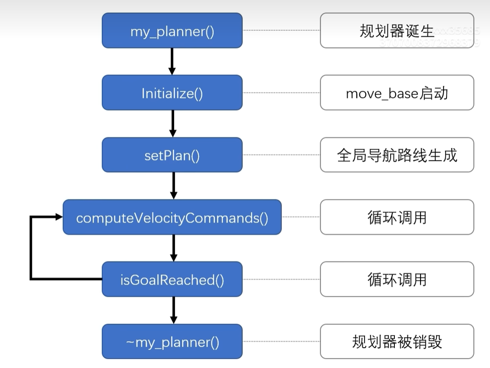
### 导航路线的获取
局部规划期的主要任务是执行全局规划器发来的全局导航路线
- `setplan()`函数的参数
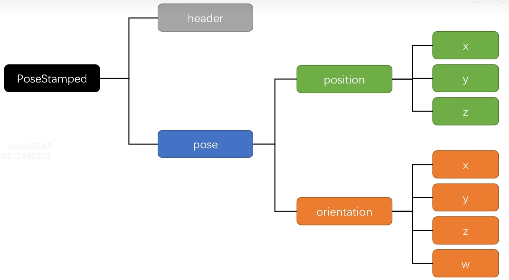
### 路径点的坐标系转换
把全局路径点的坐标值，从地图坐标系转换到机器人坐标系，使用TF工具
### 导航路线跟踪
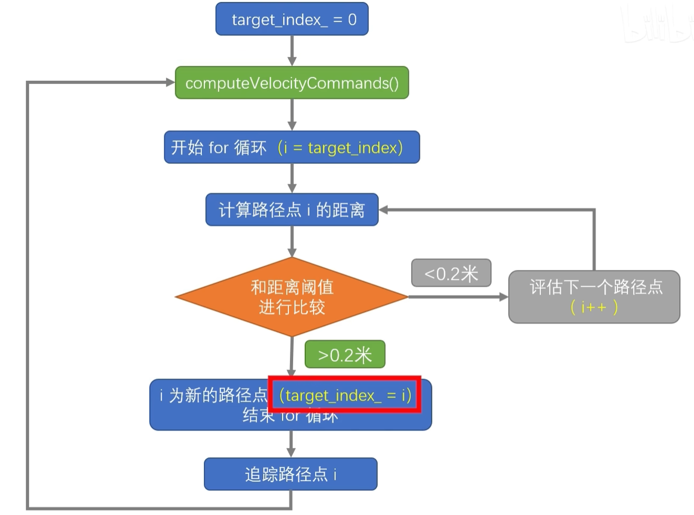
### 目标姿态处理
导航终点的姿态朝向不一定跟路径方向一致，需要咱们规划器在快要到达导航终点时，按照这个终点姿态的朝向进行必要的处理：只要靠近导航终点，就让机器人转向终点姿态的朝向
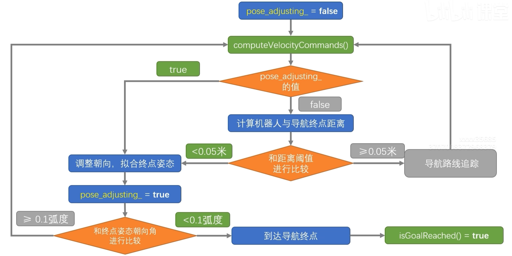
### 代价地图参数优化
为了给局部规划器添加避障功能，咱们需要获取局部代价地图的数据，代价地图里的障碍物分布情况，将成为避障决策的重要依据，因此咱们需要检查代价地图的参数设置，确保咱们在局部规划器中能够获得正确的地图数据。大部分参数使用默认值即可`视频56` 
- 参数优化
	- 代价地图的数据层 
	- 代价地图的坐标系
	- 代价地图的尺寸
	- 代价地图的分辨率
	- 代价地图的刷新频率和显示频率
	- 局部规划器的执行频率
- 这些参数通常是在move_base 节点的yaml文件里，文件名中都带有costmap这个关键词，其中影响局部代价地图的是这两个参数文件：`costmap_common_params.yaml`和`local_costmap_params.yaml`
- 在`local_costmap_params.yaml`里可配置：（如果只有一个激光雷达，并且move_base的导航功能能正常启动，下面就可以不用进行配置）
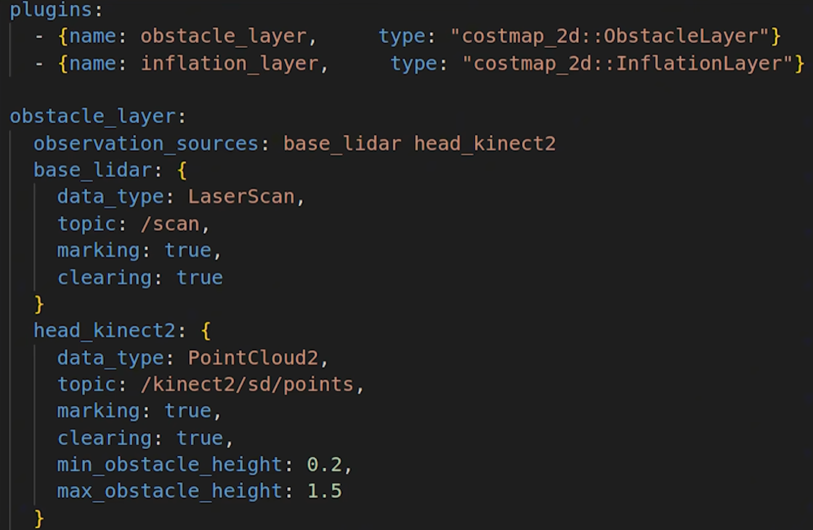
### 代价地图的数据获取
在局部规划器里获取局部代价地图数据为后面实现避障功能做准备
### 代价地图的导航路线
要在代价地图里实现避障，就需要知道障碍物有没有挡住导航路线，如何知道导航路线在代价地图里的分布呢
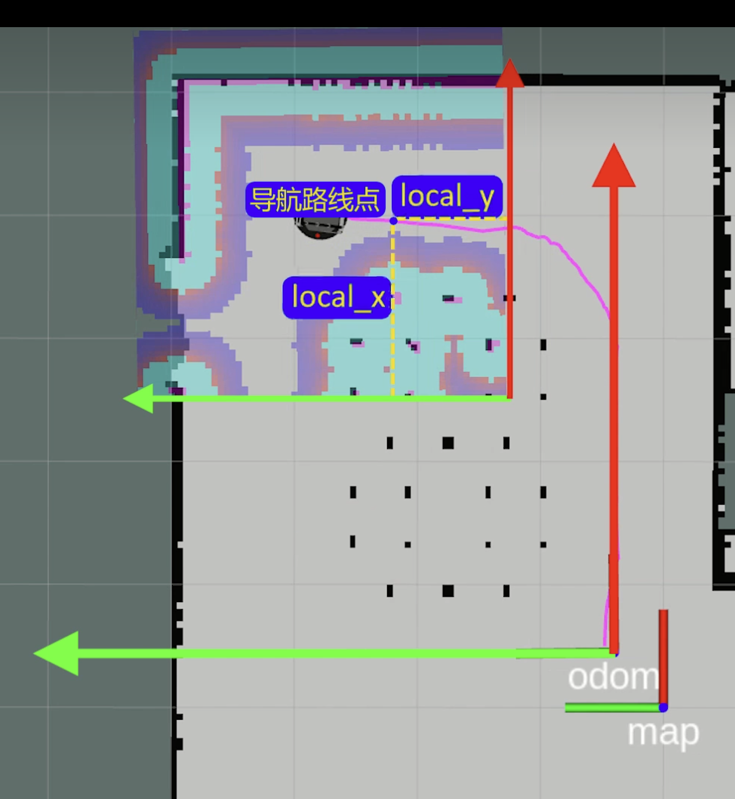
### 动态避障的实现
